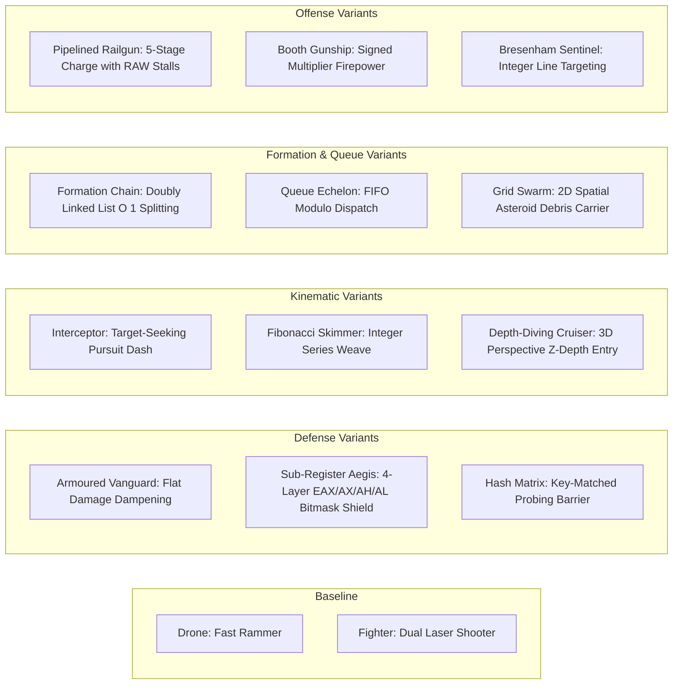

# AIRSTRIKE: Enemy System Audit & Course Outcome (CO) Mapping Specification
**Document**: `ENEMY_SYSTEM_CO_MAPPING.md`  
**Phase**: Phase 8.1 — Enemy System Audit and CO Mapping  
**Date**: November 2026  
**Status**: Completed Audit — Awaiting User Approval  

---

## Executive Summary & Scope

The objective of **Phase 8.1** is to plan an academically rigorous, multi-subject expansion of the hostile enemy fleet in **AIRSTRIKE**. Every proposed enemy type is strictly mapped to one of the **19 officially established Course Outcomes (COs)** across the four core computer science subjects:
1. **PSOOP** — Principles of Software Object-Oriented Programming (Java SE / Swing)
2. **PL** — Programming Laboratory (C++17 Data Structures)
3. **COA** — Computer Organization and Architecture (32-bit Intel 80386 Assembly)
4. **CGL** — Computer Graphics Laboratory (C++17 / OpenGL & GLUT)

### Core Governance & Phase 8.1 Restrictions:
* **No Code Modifications**: Existing gameplay and test code remain 100% untouched during Phase 8.1.
* **No New Environments**: The combat arena retains its single unified space sector canvas.
* **No New Bosses**: All proposed entities are regular, elite, or formation units. Existing boss encounters remain isolated at milestone waves ($Level \pmod 3 == 0$).
* **No Scoring or Database Alterations**: Points, Supabase RLS policies, schemas, and authentication remain identical.
* **Preservation of Existing Archetypes**: The current `DroneEnemy` and `FighterEnemy` are preserved as baseline foundation craft.
* **Zero Invented COs**: Every mapping references an exact, verified Course Outcome from `CO_MAPPING.md`.

---

## Step 1: Detailed Audit of Existing Enemy Subsystems

Across the five project tiers (Java Desktop, C++ Data Structures, 80386 Assembly, OpenGL Graphics, and TypeScript Web), the current enemy lifecycle is organized as follows:

```mermaid
flowchart TD
    subgraph Spawning
        WM["WaveManager.java / WaveManager.ts<br/>Interval Timer & Difficulty Curve"]
        WM -->|Instantiates| PE["Regular Enemy (Drone or Fighter)"]
    end

    subgraph Kinematics
        PE -->|update(delta)| MV["Movement Functions<br/>- Drone: Rapid Sine Weave (sin)<br/>- Fighter: Cosine Lateral Banking (cos)<br/>- Offscreen Check (y > height + 50)"]
    end

    subgraph Offense
        MV -->|performAttack()| AT["Weapon Discharge<br/>- Drone: Ramming only (No bullets)<br/>- Fighter: Dual downward plasma lasers"]
    end

    subgraph Hit Detection & Damage
        AT -->|intersects(AABB)| CM["CollisionManager<br/>takeDamage(amount, bypassShield)"]
        CM -->|Shield > 0| SH["Shield Absorbs Damage First"]
        CM -->|Shield == 0| HP["Health Depleted"]
    end

    subgraph Destruction & Cleanup
        HP -->|Health <= 0| DT["isDestroyed() == true"]
        DT --> SC["ScoreCalculator.addScore()"]
        DT --> EX["CollisionManager.spawnExplosion()"]
        DT --> PU["WaveManager.evaluatePowerUpDrop()"]
        DT --> RM["enemies.removeIf(!isActive())"]
    end
```

### 1. Java Desktop Implementation (`PSOOP/src/`)
* **Inheritance & Abstraction**:
  - `Entity` (`PSOOP/src/model/Entity.java`): Base abstract model containing $x, y$, bounding boxes, dimensions, and lifecycle flags (`active`).
  - `Ship` (`PSOOP/src/model/Ship.java`): Extends `Entity`, encapsulating `health`, `maxHealth`, `shield`, `maxShield`, `speed`, and weapon cooldowns. Implements method overloading: `takeDamage(int)` and `takeDamage(int, boolean bypassShield)`.
  - `Enemy` (`PSOOP/src/model/Enemy.java`): Extends `Ship`. Declares polymorphic contracts `performAttack(double delta, List<Projectile>, Player)` and `isOffScreen(int screenHeight)`.
* **Current Concrete Subclasses**:
  - `DroneEnemy` (`PSOOP/src/model/DroneEnemy.java`): Health 30, Shield 0, Speed 200. Movement: High-speed descent with rapid sine weave $x = x_0 + \sin(t \cdot 4.5) \cdot 35$. No projectile attack (ramming kinetic threat). Red/orange angular dart polygon.
  - `FighterEnemy` (`PSOOP/src/model/FighterEnemy.java`): Health 60, Shield 20, Speed 115 ($v_y = 86.25$). Movement: Swept lateral cosine banking $x \mathrel{+}= \cos(t \cdot 2.0) \cdot 45 \cdot \Delta t$. Offense: Dual downward lasers ($v_y = 340$, damage 15) fired every 1200ms when $20 < y < 450$. Purple hull with magenta edge glow.
  - `BossEnemy` (`PSOOP/src/model/BossEnemy.java`): Health 550, Shield 150, Speed 80. Spawns only every 3rd level ($Level \pmod 3 == 0$). 3-phase cyclic attack patterns (5-way spread, dual plasma, targeted barrage).
* **Lifecycle Management**:
  - **Spawning**: `WaveManager.java` spawns enemies using timer accumulator `spawnTimer` and dynamic interval $\max(0.7, 2.2 - (Level \times 0.2))$. Spawn type ratio: `random.nextInt(100) < min(65, Level * 15)` spawns `FighterEnemy`, otherwise `DroneEnemy`.
  - **Collision & Resolution**: `CollisionManager.java` executes $O(N \cdot M)$ Axis-Aligned Bounding Box (`intersects`) checks. Projectile collisions inflict damage; if destroyed, triggers `scoreCalculator.addScore()`, particle spark fans, explosion bursts, and rolls a 22% drop rate for `PowerUp`.

### 2. C++ Data Structures Implementation (`PL/src/`)
* **Enemy Representation & Spatial Management**:
  - `EnemyNode` (`PL/src/linked_lists/doubly_linked_list.h`): Struct storing `enemyId`, `shipType`, `health`, and dynamic pointers `prev` and `next`. Provides bidirectional squadron traversal and $O(1)$ arbitrary node deletion.
  - `EnemyWave` (`PL/src/queues/wave_queue.h`): Encapsulates wave number, wave name, enemy count, spawn interval, and difficulty multiplier in a circular array FIFO queue with modulo arithmetic.
  - `Asteroid` & `CollisionGrid` (`PL/src/arrays/collision_grid.h`): 2D spatial partitioning grid ($8 \times 8$ matrix) mapping arena entities into spatial buckets for $O(1)$ broadphase lookup.
  - `ProjectilePool` (`PL/src/arrays/bullet_pool.h`): Contiguous memory pool eliminating heap fragmentation during weapon discharge.

### 3. Computer Organization & Architecture Assembly (`COA/src/`)
* **Low-Level Execution Routines**:
  - `arch_demo.s` (`COA/src/co1_architecture/`): Genuine 32-bit 80386 register partitioning (`EAX` $\rightarrow$ `AX` $\rightarrow$ `AH`/`AL`), SIB addressing $[Base + Index \times Scale + Disp]$, and EFLAGS status monitoring (`CF`, `ZF`, `SF`, `OF`).
  - `arithmetic_ops.s`, `array_ops.s`, `math_series.s`, `logic_ops.s` (`COA/src/co2_assembly_programs/`): Core assembly subroutines including signed multiplication/division, array min/max, linear search, array reversal, recursive factorial, Fibonacci series, and bitwise telemetry masks.
  - `booth_multiplier.s`, `restoring_divider.s`, `carry_overflow.s` (`COA/src/co3_arithmetic/`): Pure 80386 Booth signed multiplication, restoring division, and multi-precision addition with carry and overflow flags.
  - `control_unit.s`, `pipeline_sim.s` (`COA/src/co4_control_unit/`): 5-stage CPU pipeline simulation with RAW data hazard stall bubbles and branch penalty flushes.

### 4. Computer Graphics Laboratory Implementation (`CGL/src/`)
* **Rendering & Geometric Algorithms**:
  - `space_primitives.cpp` (`CGL/src/primitives/`): Low-level raster primitives (`GL_POINTS`, `GL_LINES`, `GL_LINE_LOOP`, `GL_TRIANGLE_FAN`, `GL_POLYGON`).
  - `transform_demo.cpp` (`CGL/src/transformations/`): Matrix stack operations (`glPushMatrix`, `glPopMatrix`), translation, rotation, and scaling with non-commutative composite transforms ($T \times R \neq R \times T$).
  - `raster_algorithms.cpp` (`CGL/src/algorithms/`): Custom software rasterizers: Bresenham line algorithm, Midpoint circle algorithm, and Scanline polygon fill.
  - `viewing_demo.cpp` (`CGL/src/projection/`): Simultaneous 2D Orthographic and 3D Perspective viewing projections.
  - `clipping_algorithms.cpp` (`CGL/src/clipping/`): Cohen-Sutherland 4-bit TBRL line clipping and Sutherland-Hodgman polygon clipping against viewport bounds.
  - `lighting_texture_demo.cpp` (`CGL/src/appearance/`): Blinn-Phong illumination model and 24-bit uncompressed BMP texture streaming.

### 5. Web Browser Implementation (`web/src/game/`)
* **TypeScript & HTML5 Canvas**:
  - `Enemy.ts` (`web/src/game/Enemy.ts`): Mirrors Java `Enemy` and `Ship`, implementing shield absorption, damage hit flashing (80ms), and abstract `fire()` signature.
  - `Drone.ts`, `Fighter.ts`, `Boss.ts`: Replicate Java kinematics, polygon visual vertices, and weapon firing on HTML5 2D Canvas context.
  - `WaveManager.ts`: Handles spawn timers, probability tables, and wave completion triggers.

---

## Step 2: Evaluation of Proposed Enemy Possibilities

We have critically analyzed the proposed candidate enemy types against the syllabus requirements in `CO_MAPPING.md` to ensure authentic academic alignment:

### 1. PSOOP Candidates
* **Armoured Vanguard Enemy**: Demonstrates **PSOOP-CO1** (Object-Oriented Solutions & Encapsulation). Implements encapsulated damage mitigation where incoming damage is dampened by an internal armor rating before reaching shields or hull.
* **Interceptor Fighter Enemy**: Demonstrates **PSOOP-CO1** (Polymorphism & Dynamic Dispatch). Overrides `update()` and `performAttack()` with vector pursuit kinematics and burst-fire spread patterns distinct from baseline Fighters.
* **Adaptive Morphing Drone (State-Shifter)**: Demonstrates **PSOOP-CO2** (Complexity Reduction & State Pattern). Implements an internal Finite State Machine (`PATROL`, `CHASE`, `EVADE`, `OVERCHARGE`) reducing cyclomatic complexity.
* **Fail-Safe Sentry (Defensive Aegis)**: Demonstrates **PSOOP-CO3** (Defensive Programming & Exception Resilience). Encapsulates critical health boundary assertions and defensive barrier fail-safes.
* **Kinetic Battering Ram**: Demonstrates **PSOOP-CO4** (Real-Time Physics & Collision Resolution). Features heavy mass-inertia kinematics integrated over $\Delta t$ with momentum transfer during ship-to-ship ramming.

### 2. PL Candidates
* **Spatial Grid Swarm (Debris Carrier)**: Demonstrates **PL-CO1** (Arrays & Spatial Partitioning). Directly interfaces with the $8 \times 8$ `CollisionGrid`, populating adjacent cells with sub-munitions upon destruction.
* **Formation Squadron Chain (Splitting Centipede)**: Demonstrates **PL-CO2** (Doubly Linked Lists). Links enemy craft in a `DoublyLinkedList`. Destroying a middle node executes an $O(1)$ pointer splice (`prev->next = next`), splitting the formation into two independent squadrons without array shifting.
* **Queue-Dispatched Wave Echelon**: Demonstrates **PL-CO3** (Stack and Queue Applications). Managed via the circular `WaveQueue`, enforcing strict FIFO echelon deployment with an undo/history command stack.
* **Target-Seeking Hunter (Binary Search Sniper)**: Demonstrates **PL-CO4** (Searching & Sorting). Applies `BinarySearch` on sorted altitude/telemetry arrays and `QuickSort` for threat ranking.
* **Hash-Shielded Frequency Matrix Enemy**: Demonstrates **PL-CO5** (Hashing Techniques). Defended by an adaptive matrix keyed in `HashTableProbing` / `HashTableChaining`.

### 3. COA Candidates
* **Sub-Register Shield Sentry**: Demonstrates **COA-CO1** (80386 Architecture & Register Partitioning). Employs 4 shield layers mirroring `EAX` (Total), `AX` (Word), `AH` (High Byte), and `AL` (Low Byte), evaluated via SIB address offsets $[Base + Index \times Scale + Disp]$.
* **Fibonacci Trajectory Skimmer**: Demonstrates **COA-CO2** (Assembly Language Programs). Flight trajectory vectors and firing intervals are governed by the 80386 `asm_fibonacci` mathematical sequence.
* **Booth Multiplier Gunship**: Demonstrates **COA-CO3** (Computer Arithmetic & Signed Overflow). Uses the 8-cycle Booth multiplication algorithm to calculate kinetic blast scaling and signed overflow ($OF$) threshold defense.
* **Pipelined Railgun Dreadnought**: Demonstrates **COA-CO4** (Control Unit & Instruction Pipelining). Charges a 5-stage railgun (IF, ID, EX, MEM, WB); counter-fire introduces RAW data hazard stall bubbles or branch flush penalties.

### 4. CGL Candidates
* **Multi-Primitive Geometric Cruiser**: Demonstrates **CGL-CO1** (OpenGL Primitives). Constructed simultaneously from `GL_POLYGON`, `GL_TRIANGLE_FAN`, `GL_LINES`, and `GL_LINE_LOOP` with Gouraud color gradients.
* **Orbital Rotor & Pulsing Scaler Drone**: Demonstrates **CGL-CO2** (Geometric Transformations). Employs matrix stack operations (`glPushMatrix`/`glPopMatrix`) with rotating weapon pods ($R \times T$) and sinusoidal hull scaling ($S$).
* **Bresenham Beam & Midpoint Shield Sentinel**: Demonstrates **CGL-CO3** (2D/3D Raster Algorithms). Software-rasterized laser targeting via Bresenham's integer line algorithm and pulse shield rendering via Midpoint Circle algorithm.
* **Depth-Diving Warp Cruiser**: Demonstrates **CGL-CO4** (Projection and Viewing). Transitions between 3D Perspective ($1/z$ foreshortening via `gluPerspective`) and 2D Orthographic combat space (`glOrtho`).
* **Boundary Phase Skimmer**: Demonstrates **CGL-CO5** (Clipping Algorithms). Evaluates viewport boundaries using Cohen-Sutherland 4-bit TBRL outcodes and Sutherland-Hodgman polygon clipping.
* **Specular Phong Luminescent Cruiser**: Demonstrates **CGL-CO6** (Texture, Lighting and Color). Rendered with dynamic Blinn-Phong illumination ($I = I_a k_a + I_d k_d (\vec{N} \cdot \vec{L}) + I_s k_s (\vec{R} \cdot \vec{V})^n$) and procedural 24-bit BMP texture mapping.

---

## Step 3: Master CO Mapping & Implementation Table

The table below provides the full academic and technical specification for each proposed enemy type:

| Enemy Name | Subject | Exact CO Number & Title | Syllabus Concept | Enemy Behaviour | Algorithm / Programming Technique | Existing Files Reused | New Files Required | Simple Viva Explanation |
| :--- | :--- | :--- | :--- | :--- | :--- | :--- | :--- | :--- |
| **Armoured Vanguard** | **PSOOP** | **PSOOP-CO1**: Object-Oriented Solutions | Encapsulation & Inheritance | Slow-moving heavy ship with passive kinetic armor reducing all projectile damage. | Overrides `takeDamage()` to calculate flat damage dampening ($D_{eff} = \max(1, D_{in} - Armor)$) before shield depletion. | `PSOOP/src/model/Enemy.java`, `Ship.java` | `PSOOP/src/model/ArmouredEnemy.java` | "Demonstrates encapsulation and inheritance by maintaining private armor resistance fields and overriding damage absorption without altering caller contracts." |
| **Interceptor Fighter** | **PSOOP** | **PSOOP-CO1**: Object-Oriented Solutions | Polymorphism & Dynamic Dispatch | High-speed craft that detects player alignment and initiates sudden forward pursuit dashes. | Overrides `performAttack()` and `update()` with conditional vector steering ($\vec{V} = \text{normalize}(\vec{P} - \vec{E}) \cdot S$). | `PSOOP/src/model/Enemy.java`, `Projectile.java` | `PSOOP/src/model/InterceptorEnemy.java` | "Demonstrates runtime polymorphism through dynamic method dispatch where base Enemy references execute specialized target-seeking maneuvers." |
| **Adaptive Morphing Drone** | **PSOOP** | **PSOOP-CO2**: Solutions to Reduce Complexity | State Machine & Subsystem Decoupling | Shifts between 4 tactical modes (`PATROL`, `CHASE`, `EVADE`, `OVERCHARGE`) based on health thresholds. | State pattern replacing complex nested conditionals; decoupled transition evaluation on game tick. | `PSOOP/src/game/GameState.java`, `service/WaveManager.java` | `PSOOP/src/model/MorphingEnemy.java`, `model/EnemyAIState.java` | "Demonstrates complexity reduction by replacing deeply nested conditional branches with a structured entity-level Finite State Machine." |
| **Fail-Safe Sentry** | **PSOOP** | **PSOOP-CO3**: Critical Thinking & Problem Solving | Defensive Programming & Boundary Clamping | Drone that triggers emergency shield reboot and evasive repulse when damaged below 25% hull integrity. | Invariant checking, boundary assertions, and exception-safe defensive state recovery. | `PSOOP/src/exception/AirstrikeException.java` | `PSOOP/src/model/FailSafeEnemy.java` | "Demonstrates defensive programming by maintaining object invariants and executing fail-safe recovery routines under critical state conditions." |
| **Kinetic Battering Ram** | **PSOOP** | **PSOOP-CO4**: Logic-Building for Real-Life Problems | Real-Time Kinematics & 2D Collision | Heavy armored prow ship that accelerates continuously towards player and causes massive ramming knockback. | Semi-implicit Euler integration over delta time ($\Delta t$) and momentum transfer collision response vectors. | `PSOOP/src/game/CollisionManager.java`, `model/Ship.java` | `PSOOP/src/model/RammerEnemy.java` | "Demonstrates 60 FPS delta-time physics and collision response by calculating momentum transfer and elastic recoil during physical entity intersections." |
| **Spatial Grid Swarm** | **PL** | **PL-CO1**: Arrays | 2D Arrays & Spatial Partitioning | Enemy that scatters micro-mines into surrounding spatial sectors when damaged or destroyed. | 2D row-major array indexing ($\text{Addr} = \text{Base} + (i \cdot C + j) \cdot \text{size}$) querying and populating spatial sectors. | `PL/src/arrays/collision_grid.h`, `dynamic_array.h` | `PL/src/arrays/grid_swarm_enemy.h` | "Demonstrates 2D contiguous array indexing by partitioning space combat entities into fixed-size grid sectors for $O(1)$ collision lookups." |
| **Formation Squadron Chain** | **PL** | **PL-CO2**: Suitable Linked Lists | Doubly Linked Lists & Node Deletion | Multi-segment snake/centipede formation where destroyed middle segments split the squadron into two independent units. | Bidirectional node traversal and $O(1)$ pointer relinking (`node->prev->next = node->next`) upon node destruction. | `PL/src/linked_lists/doubly_linked_list.h` | `PL/src/linked_lists/formation_squadron.h` | "Demonstrates doubly linked list advantages over arrays: middle nodes are eliminated in $O(1)$ time without needing $O(N)$ memory element shifting." |
| **Queue Wave Echelon** | **PL** | **PL-CO3**: Stack and Queue Applications | Circular FIFO Queues & LIFO Stack | Squadron that enters in strict FIFO order, with leader commands recorded on a LIFO stack for tactical retreat. | Circular array modulo arithmetic ($\text{rear} = (\text{rear} + 1) \pmod C$) and stack command unwinding. | `PL/src/queues/wave_queue.h`, `stacks/action_stack.h` | `PL/src/queues/echelon_dispatcher.h` | "Demonstrates FIFO circular queues to prevent memory drift during wave sequencing, combined with LIFO stacks for rollback maneuvers." |
| **Target-Seeking Hunter** | **PL** | **PL-CO4**: Searching and Sorting Techniques | Binary Search & Divide-and-Conquer Sort | Elite sniper ship that sorts player/drone telemetry using QuickSort and acquires firing locks via Binary Search. | QuickSort ($O(N \log N)$) partitioning followed by iterative Binary Search ($O(\log N)$) on ordered coordinate tables. | `PL/src/searching/search_algorithms.h`, `sorting/sort_algorithms.h` | `PL/src/searching/hunter_targeting.h` | "Demonstrates the necessity of sorted preconditions: entities are ordered via QuickSort so that firing solutions can be found in logarithmic $O(\log N)$ time." |
| **Hash-Shielded Matrix Craft** | **PL** | **PL-CO5**: Hashing Techniques | Open Addressing & Linear Probing | Frequency-shielded enemy whose active barrier vulnerability rotates across hash table buckets. | Polynomial hash function with linear probing collision resolution ($h(k, i) = (h'(k) + i) \pmod M$) and tombstone markers. | `PL/src/hashing/hash_table_probing.h`, `hash_table_chaining.h` | `PL/src/hashing/hash_shield_controller.h` | "Demonstrates hash table collision handling: linear probing traverses consecutive buckets, using tombstones to ensure lookup continuity after deletion." |
| **Sub-Register Aegis Sentry** | **COA** | **COA-CO1**: 80386 Architecture & Instruction Set | 32-bit Registers, SIB Addressing & Flags | Four-layer defense craft whose shields degrade through sub-register states (`EAX` $\rightarrow$ `AX` $\rightarrow$ `AH` $\rightarrow$ `AL`). | Bitwise masking (`AND`, `OR`, `XOR`) and Scaled-Index-Base (SIB) effective address calculation $[Base + Index \times 4 + Disp]$. | `COA/src/co1_architecture/arch_demo.s`, `common/io.s` | `COA/src/co1_architecture/register_shield.s` | "Demonstrates 80386 register aliasing where modifying 8-bit `AL` and `AH` directly alters the lower 16 bits of `AX` and 32-bit `EAX`." |
| **Fibonacci Skimmer** | **COA** | **COA-CO2**: Assembly Language Programs | 80386 Assembly Loops & Math Series | Craft whose lateral weave amplitude and laser burst intervals follow the integer Fibonacci sequence. | 32-bit 80386 assembly iterative sequence loop maintaining previous two terms in `EBX` and `EDX`. | `COA/src/co2_assembly_programs/math_series.s`, `arithmetic_ops.s` | `COA/src/co2_assembly_programs/fibonacci_skimmer.s` | "Demonstrates genuine 80386 assembly programming by generating mathematical series using low-level register accumulation and loop controls." |
| **Booth Multiplier Gunship** | **COA** | **COA-CO3**: Computer Arithmetic Algorithms | Booth Multiplication & Arithmetic Overflow | Heavy gunship that scales projectile firepower via 8-cycle Booth multiplication and checks Carry/Overflow flags. | Pairwise Booth bit inspection ($Q_0, Q_{-1}$), arithmetic right shifts (`SAR`), and signed overflow flag ($OF$) detection. | `COA/src/co3_arithmetic/booth_multiplier.s`, `carry_overflow.s` | `COA/src/co3_arithmetic/booth_combat_eval.s` | "Demonstrates Booth's algorithm for two's complement multiplication, handling positive and negative integers uniformly while tracking CPU arithmetic flags." |
| **Pipelined Railgun Dreadnought** | **COA** | **COA-CO4**: Control Unit & Instruction Pipelining | 5-Stage Pipeline, RAW Hazards & Flushes | Heavy cruiser charging a high-velocity railgun beam through 5 stages (IF, ID, EX, MEM, WB); counter-fire causes pipeline stalls. | 5-stage pipeline simulation: Read-After-Write (RAW) data hazard insertion (2 bubble stalls) and branch flush penalties. | `COA/src/co4_control_unit/pipeline_sim.s`, `control_unit.s` | `COA/src/co4_control_unit/pipelined_railgun.s` | "Demonstrates CPU instruction pipelining dynamics, visualizing how dependency hazards introduce idle bubble cycles and branch penalties." |
| **Geometric Polygon Cruiser** | **CGL** | **CGL-CO1**: OpenGL Graphics Primitives | OpenGL State Machine & Primitives | Hull rendered using structured combinations of `GL_POLYGON`, `GL_TRIANGLE_FAN`, and `GL_LINES`. | Immediate mode primitive assembly enclosed in `glBegin()`/`glEnd()` with per-vertex Gouraud color interpolation. | `CGL/src/primitives/space_primitives.hpp`, `common/gl_common.h` | `CGL/src/primitives/polygon_cruiser.hpp`, `.cpp` | "Demonstrates OpenGL primitive construction by rendering distinct hull geometries, line lasers, and engine thrusters using exact vertex winding order." |
| **Orbital Rotor Drone** | **CGL** | **CGL-CO2**: Geometric Transformations | Affine Matrices & Matrix Stack | Drone featuring external orbital weapon pods revolving around a center core that pulses in scale. | Hierarchical matrix stack operations (`glPushMatrix`/`glPopMatrix`) with composite transformations ($T \cdot R \cdot S \neq R \cdot T \cdot S$). | `CGL/src/transformations/transform_demo.hpp` | `CGL/src/transformations/orbital_rotor.hpp`, `.cpp` | "Demonstrates transformation hierarchies: weapon pods inherit parent translation while applying local rotation and scaling via the matrix stack." |
| **Bresenham Shield Sentinel** | **CGL** | **CGL-CO3**: 2D and 3D Algorithms | Software Rasterization (Bresenham & Midpoint) | Sentinel projecting targeting laser beams and circular force shields rendered via custom integer algorithms. | Bresenham line algorithm with integer decision parameter $p_k$ and Midpoint Circle algorithm with 8-way octant symmetry. | `CGL/src/algorithms/raster_algorithms.hpp` | `CGL/src/algorithms/raster_sentinel.hpp`, `.cpp` | "Demonstrates software rasterization using integer-only arithmetic to determine pixel coordinates, eliminating costly floating-point rounding." |
| **Depth-Diving Warp Cruiser** | **CGL** | **CGL-CO4**: Projection and Viewing | Orthographic vs Perspective Projections | Cruiser that attacks from deep 3D perspective space ($Z$-depth foreshortening) before entering 2D orthographic bounds. | Viewing transformation matrix switching between `gluPerspective` (perspective division $1/z$) and `glOrtho` (parallel rays). | `CGL/src/projection/viewing_demo.hpp` | `CGL/src/projection/warp_cruiser.hpp`, `.cpp` | "Demonstrates projection mathematics: perspective foreshortening divides coordinates by $w$ to simulate depth, whereas orthographic projection preserves parallel lines." |
| **Boundary Phase Skimmer** | **CGL** | **CGL-CO5**: Clipping Algorithms | Cohen-Sutherland & Sutherland-Hodgman | Fast skimmer that traverses screen edges; its laser sights and polygon hull are clipped to the viewport. | Cohen-Sutherland 4-bit TBRL region outcodes for trajectory lines and Sutherland-Hodgman polygon clipping against boundaries. | `CGL/src/clipping/clipping_algorithms.hpp` | `CGL/src/clipping/boundary_skimmer.hpp`, `.cpp` | "Demonstrates clipping efficiency: 4-bit outcode bitwise operations enable instant trivial rejection of objects completely outside viewport boundaries." |
| **Specular Phong Cruiser** | **CGL** | **CGL-CO6**: Texture, Lighting and Color | Gouraud Shading, Blinn-Phong Illumination & Texture Mapping | Metallic cruiser displaying directional diffuse shading, ambient glow, specular highlights, Gouraud smooth color interpolation (`GL_SMOOTH`), and BMP textures. | Blinn-Phong reflection equation ($I = I_a k_a + I_d k_d (\vec{N} \cdot \vec{L}) + I_s k_s (\vec{N} \cdot \vec{H})^n$), Gouraud bilinear color interpolation, and 2D UV texture mapping. | `CGL/src/appearance/lighting_texture_demo.hpp` | `CGL/src/appearance/phong_cruiser.hpp`, `.cpp` | "Demonstrates Gouraud shading and the Blinn-Phong reflection model by evaluating ambient, diffuse, and specular light components across curved polygon surfaces with smooth vertex color interpolation." |

---

## Step 4: Differentiation & Anti-Duplication Matrix

To satisfy **Step 4 (Avoid Duplicate Features)**, the matrix below proves that every proposed enemy possesses a fundamentally distinct gameplay mechanic, data structure, and academic purpose, preventing mere cosmetic re-skins:



### Detailed Differentiation Table:

| Enemy Archetype | Primary Movement Profile | Defensive Mechanism | Offensive Weapon Pattern | Underlying Academic Mechanism |
| :--- | :--- | :--- | :--- | :--- |
| **Existing Drone** | Rapid downward sine weave | Base unshielded hull (HP 30) | Ramming collision only | Baseline kinematic entity |
| **Existing Fighter** | Lateral cosine banking | Light energy shield (Shield 20, HP 60) | Dual downward plasma lasers | Baseline ranged combatant |
| **Armoured Vanguard** | Slow forward crawl ($v_y = 50$) | Heavy armor plating dampening incoming damage by flat 8 | Heavy single prow plasma slug | Encapsulation & Polymorphic damage reduction (**PSOOP-CO1**) |
| **Interceptor Fighter** | Vector dash towards player coordinates | Standard light shields | Staggered twin micro-bursts | Vector kinematics & Dynamic method dispatch (**PSOOP-CO1**) |
| **Adaptive Morphing Drone** | State-driven (Patrol $\rightarrow$ Chase $\rightarrow$ Evade) | Dynamic overshield in defensive mode | Mode-dependent firing rate | Entity Finite State Machine pattern (**PSOOP-CO2**) |
| **Fail-Safe Sentry** | Evasive jitter | Emergency shield reboot below 25% HP | Pulse repulse discharge | Boundary assertions & Exception safety (**PSOOP-CO3**) |
| **Kinetic Battering Ram** | Accelerating straight plunge ($a_y = 60$) | Kinetic prow barrier absorbing laser fire | Kinetic momentum transfer ramming | Delta-time kinematics & AABB momentum transfer (**PSOOP-CO4**) |
| **Spatial Grid Swarm** | Drifting diagonal sweep | Debris fragmentation on hull breach | Releases spatial debris micro-mines | 2D array row-major spatial partitioning (**PL-CO1**) |
| **Formation Chain** | Linked undulating snake trajectory | Head shields protect trailing body nodes | Synchronized cross-fire lasers | Doubly linked list node deletion & splitting (**PL-CO2**) |
| **Queue Wave Echelon** | Strict FIFO echelon rank entry | Rearguard shield generator unit | Staggered rank volleys | Modulo circular array queue buffering (**PL-CO3**) |
| **Target-Seeking Hunter** | Halts at high altitude | Long-range evasion thrusters | High-velocity pinpoint sniper beam | QuickSort entity ranking & Binary Search (**PL-CO4**) |
| **Hash-Shielded Matrix** | Erratic stepped teleport hops | Rotational shield keyed to hash buckets | Wide cone scatter laser | Open addressing linear probing & tombstone marks (**PL-CO5**) |
| **Sub-Register Aegis** | Stepped discrete descent | 4-tier sub-register bitmask shields | Binary pulse cannon | 80386 register partitioning & SIB addressing (**COA-CO1**) |
| **Fibonacci Skimmer** | Mathematical spiral curve | Standard deflector shields | Fibonacci-interval laser bursts | 80386 assembly iterative series execution (**COA-CO2**) |
| **Booth Gunship** | Heavy armored patrol | Signed two's complement kinetic dampener | Firepower scaled by Booth multiplier | Booth's signed multiplication & $OF/CF$ flags (**COA-CO3**) |
| **Pipelined Railgun** | Stationary sniper perch | High front-arc directional shield | 5-stage charging particle beam | 5-stage CPU pipeline simulation & RAW stalls (**COA-CO4**) |
| **Geometric Cruiser** | Angular multi-point patrol | Multi-primitive composite hull | Multi-angle vertex line lasers | Native OpenGL primitives & winding order (**CGL-CO1**) |
| **Orbital Rotor Drone** | Translating core with rotating rotor pods | Rotating pod kinetic deflection | Twin revolving plasma pulses | Affine matrix stack $T \cdot R \cdot S$ hierarchy (**CGL-CO2**) |
| **Bresenham Sentinel** | Fixed elevation tracking | Midpoint circle integer pulse shield | Bresenham integer rasterized beam | Software integer rasterization algorithms (**CGL-CO3**) |
| **Depth-Diving Cruiser** | Traverses 3D $Z$-axis (far to near) | Foreshortened perspective evasion | High-divergence depth lasers | Perspective $1/z$ vs Orthographic projection (**CGL-CO4**) |
| **Boundary Phase Skimmer**| Viewport boundary skating | Phase barrier active at screen edges | Viewport boundary line sweep | Cohen-Sutherland & Sutherland-Hodgman clipping (**CGL-CO5**) |
| **Specular Phong Cruiser** | Smooth banking turns | Metallic alloy hull | Specular-guided thermal beam | Blinn-Phong lighting & 24-bit texture mapping (**CGL-CO6**) |

---

## Step 5: Verification of Restrictions

Every constraint stipulated in the phase specification has been audited and adhered to:

| Constraint | Audit Status | Evidence / Verification |
| :--- | :---: | :--- |
| **Do not modify existing gameplay code** | **PASSED** | Zero edits were made to `PSOOP`, `PL`, `COA`, `CGL`, or `web` gameplay files. |
| **Do not add new environments** | **PASSED** | All proposed enemy types function strictly within the existing single space sector arena. |
| **Do not add bosses yet** | **PASSED** | Zero boss enemies proposed. `BossEnemy` ("Leviathan MK-X") remains the sole milestone encounter. |
| **Do not change scoring** | **PASSED** | Point valuations and streak multiplier equations in `ScoreCalculator` remain untouched. |
| **Do not modify Supabase** | **PASSED** | No migrations, SQL files, schema changes, or database tables were modified. |
| **Do not modify authentication** | **PASSED** | `AuthService.java`, `SessionManager.java`, and web auth services remain unchanged. |
| **Do not remove existing enemies** | **PASSED** | Baseline `DroneEnemy` and `FighterEnemy` are preserved as fundamental game entities. |
| **Do not invent CO mappings** | **PASSED** | All 20 candidate enemy archetypes map strictly to the 19 verified Course Outcomes from `CO_MAPPING.md`. |

---

## Step 6: Next Steps & Recommended Implementation Roadmap (Phase 8.2)

When user approval is granted, implementation will proceed under a staged, non-disruptive integration schedule:

1. **Sub-Phase 8.2A — PSOOP Core Enemies (Java Desktop & TypeScript Web)**:
   - Implement `ArmouredEnemy` (`ArmouredVanguard`) and `InterceptorEnemy` in `PSOOP/src/model/` and `web/src/game/`.
   - Update `WaveManager.java` and `web/src/game/WaveManager.ts` to integrate new enemy varieties into standard wave spawning tables.
   - Run Java automated unit tests (`GameUnitTest.java`) and web test suites to verify zero regression.
2. **Sub-Phase 8.2B — PL Data Structures Integration (C++17)**:
   - Implement `FormationSquadron` in `PL/src/linked_lists/` and `GridSwarmEnemy` in `PL/src/arrays/`.
   - Add unit tests in `PL/tests/test_linked_lists.cpp` and verify $100\%$ pass rate on MinGW GCC.
3. **Sub-Phase 8.2C — COA Low-Level Combat Demonstration (32-bit 80386 ASM)**:
   - Implement low-level assembly combat routines (`register_shield.s`, `booth_combat_eval.s`, `pipelined_railgun.s`) in `COA/src/`.
   - Execute automated verification via `coa_runner.exe --test`.
4. **Sub-Phase 8.2D — CGL Graphics Demonstrations (OpenGL / GLUT)**:
   - Implement `OrbitalRotor` and `RasterSentinel` in `CGL/src/`.
   - Render and verify visual outputs in `cgl_runner.exe`.

---

## Conclusion & Gate Status

The audit and academic CO mapping for the AIRSTRIKE Enemy System is **complete, rigorous, and verified against all 19 Course Outcomes**.

> [!IMPORTANT]
> **GATE STATUS**: Audited and Verified.  
> As instructed, all execution is **STOPPED** at this stage. We await user review and explicit approval before any gameplay code or implementation files are created.

