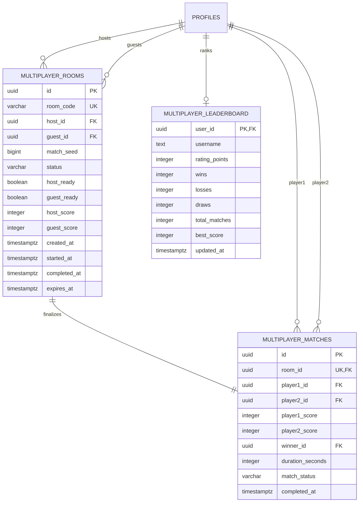
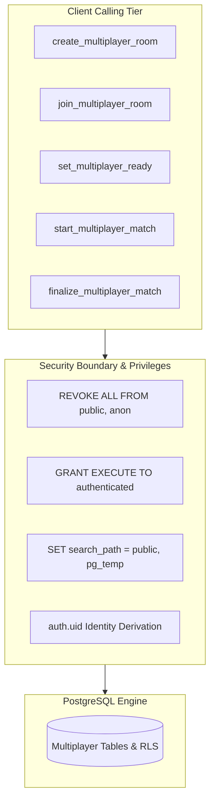

# AIRSTRIKE: Phase 12 — Multiplayer Implementation
## PART 2: MULTIPLAYER DATABASE & SECURE BACKEND REPORT

**Document Identifier**: `docs/MULTIPLAYER_PART_2_BACKEND_REPORT.md`  
**Phase**: Phase 12.2 — Competitive 1v1 Online Multiplayer Database & Secure Backend Architecture  
**Version**: 1.0.0  
**Date**: November 2026  
**Status**: Backend Schema & Test Suites Complete — DORMANT (Zero direct production execution without human review)  
**Governance**: Strict Zero-Impact Isolation (Preserves all single-player tables, auth, RLS, and all 19 Course Outcomes)

---

## 1. Executive Summary

In **Phase 12 (Part 2)**, the foundational database schema and secure backend architecture for **AIRSTRIKE 1v1 Online Multiplayer** have been established. This architecture enables two authenticated student pilots to create combat rooms, receive collision-free room codes, execute mutual ready checks, start matches with synchronized deterministic seeds, and finalize matches with server-authoritative score resolution and rating point distribution.

### Core Governance & Safety Guarantees:
- **Zero Premature Gameplay Changes**: No room UI or in-game multiplayer networking has been implemented yet.
- **Zero Destructive Schema Operations**: No existing tables (`public.profiles`, `public.matches`, `public.leaderboard`) were dropped, renamed, or altered.
- **Dormant Migration Policy**: The migration file has been authored with transactional wrappers (`BEGIN...COMMIT`) and preflight safety checks, and is stored at `supabase/migrations/20261111_phase12_multiplayer_schema.sql` for human review prior to production execution in the Supabase SQL Editor.
- **Rollback Preparedness**: A complete rollback script is provided at `supabase/migrations/20261111_phase12_multiplayer_rollback.sql`.

---

## 2. Database Objects Created



### 2.1 Table: `public.multiplayer_rooms`
Manages the lifecycle of 1v1 combat lobbies, tracking membership, ready checks, and ephemeral match configurations:
- `id` (`UUID PRIMARY KEY DEFAULT gen_random_uuid()`): Unique room identifier.
- `room_code` (`VARCHAR(8) NOT NULL UNIQUE`): 6-character uppercase alphanumeric room code (e.g., `A8X4KP`), excluding ambiguous characters (`0`, `O`, `1`, `I`, `L`).
- `host_id` (`UUID NOT NULL REFERENCES public.profiles(id) ON DELETE CASCADE`): Authenticated pilot creating the room.
- `guest_id` (`UUID REFERENCES public.profiles(id) ON DELETE SET NULL`): Second authenticated pilot joining the room.
- `match_seed` (`BIGINT NOT NULL`): Positive 64-bit pseudo-random seed shared between clients to guarantee identical deterministic enemy wave sequences.
- `status` (`VARCHAR(20) NOT NULL DEFAULT 'WAITING'`): Current lobby state constrained to `'WAITING'`, `'READY'`, `'COUNTDOWN'`, `'ACTIVE'`, `'COMPLETED'`, `'CANCELLED'`.
- `host_ready` (`BOOLEAN NOT NULL DEFAULT false`): Ready status flag for host.
- `guest_ready` (`BOOLEAN NOT NULL DEFAULT false`): Ready status flag for guest.
- `host_score` (`INTEGER DEFAULT NULL`): Score submitted by host at match completion.
- `guest_score` (`INTEGER DEFAULT NULL`): Score submitted by guest at match completion.
- `created_at` (`TIMESTAMPTZ NOT NULL DEFAULT timezone('utc'::text, now())`): Room creation timestamp.
- `started_at` (`TIMESTAMPTZ DEFAULT NULL`): Timestamp when combat officially began.
- `completed_at` (`TIMESTAMPTZ DEFAULT NULL`): Timestamp when match was finalized.
- `expires_at` (`TIMESTAMPTZ NOT NULL DEFAULT (now() + interval '15 minutes')`): Auto-expiration cutoff to prevent abandoned lobbies from lingering.

### 2.2 Table: `public.multiplayer_matches`
Permanent audit log of all completed 1v1 competitive matches:
- `id` (`UUID PRIMARY KEY DEFAULT gen_random_uuid()`): Unique match record ID.
- `room_id` (`UUID NOT NULL UNIQUE REFERENCES public.multiplayer_rooms(id)`): Unique 1:1 foreign key binding to the room. Prevents duplicate match recordings.
- `player1_id` (`UUID NOT NULL REFERENCES public.profiles(id)`): Identity of host.
- `player2_id` (`UUID NOT NULL REFERENCES public.profiles(id)`): Identity of guest.
- `player1_score` (`INTEGER NOT NULL DEFAULT 0`): Validated score achieved by Player 1.
- `player2_score` (`INTEGER NOT NULL DEFAULT 0`): Validated score achieved by Player 2.
- `winner_id` (`UUID REFERENCES public.profiles(id)`): Identity of winning pilot (`NULL` indicates a Draw).
- `duration_seconds` (`INTEGER NOT NULL DEFAULT 90`): Total battle duration in seconds.
- `match_status` (`VARCHAR(20) NOT NULL DEFAULT 'COMPLETED'`): Constrained to `'COMPLETED'`, `'ABORTED'`, `'FORFEIT'`.
- `completed_at` (`TIMESTAMPTZ NOT NULL DEFAULT timezone('utc'::text, now())`): Match completion timestamp.

### 2.3 Table: `public.multiplayer_leaderboard`
Maintains competitive MMR (Matchmaking Rating) and pilot win/loss telemetry:
- `user_id` (`UUID PRIMARY KEY REFERENCES public.profiles(id) ON DELETE CASCADE`): Pilot UUID.
- `username` (`TEXT NOT NULL`): Pilot callsign cached from `public.profiles`.
- `rating_points` (`INTEGER NOT NULL DEFAULT 1000`): Competitive rating points (starts at 1000).
- `wins` (`INTEGER NOT NULL DEFAULT 0`): Total multiplayer victories.
- `losses` (`INTEGER NOT NULL DEFAULT 0`): Total multiplayer defeats.
- `draws` (`INTEGER NOT NULL DEFAULT 0`): Total multiplayer ties.
- `total_matches` (`INTEGER NOT NULL DEFAULT 0`): Sum of wins + losses + draws.
- `best_score` (`INTEGER NOT NULL DEFAULT 0`): All-time highest score achieved in a multiplayer match.
- `updated_at` (`TIMESTAMPTZ NOT NULL DEFAULT timezone('utc'::text, now())`): Timestamp of latest match update.

#### Pedagogical Rationale: Physical Table vs. View
> [!IMPORTANT]
> A **physical table** was intentionally selected over a dynamic SQL view for three critical reasons:
> 1. **Transactional Row Locking (`SELECT ... FOR UPDATE`)**: A physical table permits row-level locks during match finalization, preventing race conditions when two matches complete concurrently for the same user.
> 2. **$O(1)$ Indexed Query Performance**: Indexed by `(rating_points DESC, wins DESC)`, allowing instant retrieval of the Top 10/Top 50 Hall of Fame without executing an expensive `GROUP BY` and full-table aggregation over thousands of match history rows on every student page load.
> 3. **Atomic Incremental Mutation**: Wins, losses, and rating points are incremented atomically inside the finalization stored procedure, guaranteeing data consistency.

---

## 3. Secure PostgreSQL Stored Procedures (RPCs)

All mutations are strictly routed through five `SECURITY DEFINER` functions with hardened execution privileges and sanitized search paths:



### 3.1 `public.generate_multiplayer_room_code()`
- **Purpose**: Generates a 6-character cryptographically secure collision-free room code.
- **Entropy**: Sampled from a 32-character alphabet (`ABCDEFGHJKLMNPQRSTUVWXYZ23456789`), excluding visually ambiguous glyphs (`0`, `O`, `1`, `I`, `L`).
- **Collision Resistance**: $32^6 = 1,073,741,824$ potential codes. Verifies non-existence in active rooms via loop guard ($<100$ attempts).

### 3.2 `public.create_multiplayer_room()`
- **Security**: Derives `host_id` directly from `auth.uid()`. Throws `42501` if called by an unauthenticated session.
- **Cleanup**: Automatically cancels any abandoned, unexpired `WAITING` rooms previously created by the same host.
- **Seed Generation**: Computes a positive 63-bit integer `match_seed` from cryptographic hashes for client wave generation.
- **Returns**: `{ success: true, room_id, room_code, host_id, host_username, match_seed, status: 'WAITING', expires_at }`.

### 3.3 `public.join_multiplayer_room(p_room_code text)`
- **Security**: Row lock acquired via `SELECT ... FOR UPDATE`.
- **Validation Guards**:
  - Rejects null or blank room codes.
  - Verifies room exists and is unexpired (`expires_at > now()`).
  - Verifies room `status = 'WAITING'`.
  - **Self-Join Prevention**: Strictly rejects if `host_id = auth.uid()` (`SELF_JOIN_FORBIDDEN`).
  - **Third-Player Prevention**: Strictly rejects if `guest_id IS NOT NULL` (`ROOM_FULL`).
- **State Transition**: Sets `guest_id = auth.uid()` and advances room status to `'READY'`.

### 3.4 `public.set_multiplayer_ready(p_room_id uuid)`
- **Security**: Row lock acquired via `SELECT ... FOR UPDATE`.
- **Membership Check**: Asserts `auth.uid() IN (host_id, guest_id)`. Rejects non-participants.
- **Incomplete Room Guard**: Rejects ready toggle if `guest_id` is null.
- **Countdown Trigger**: Toggles `host_ready` or `guest_ready`. If both players have set ready, transitions status to `'COUNTDOWN'`.

### 3.5 `public.start_multiplayer_match(p_room_id uuid)`
- **Security**: Row lock acquired via `SELECT ... FOR UPDATE`.
- **State Guard**: Only permits start if status is `'COUNTDOWN'` or `'READY'`. Idempotently returns active state if already `'ACTIVE'`.
- **Timestamping**: Sets `started_at = now()` and status to `'ACTIVE'`.

### 3.6 `public.finalize_multiplayer_match(p_room_id uuid, p_submitted_score int, p_duration_seconds int)`
- **Security**: Row lock acquired via `SELECT ... FOR UPDATE`.
- **Untrusted Score Handling**: Client-submitted score is validated against physical rate bounds:
  $$\text{score} \le (\text{duration} \times 450) + 2000$$
  Scores exceeding theoretical maximum enemy density are rejected.
- **Idempotency Guard**: If room is already `'COMPLETED'`, returns existing match record without re-awarding points.
- **Two-Phase Score Collection**:
  - If only one player has submitted, updates caller's score (`host_score` or `guest_score`) and returns `'PENDING_OPPONENT'`.
  - Once both scores are submitted, executes **Atomic Match Resolution**:
    1. Compares `host_score` vs `guest_score`.
    2. Identifies `winner_id` (`NULL` if equal/draw).
    3. Inserts match record into `public.multiplayer_matches`.
    4. Transitions room to `'COMPLETED'`.
    5. Updates `public.multiplayer_leaderboard` for both players transactionally:
       - **Winner**: $+25$ rating points, $+1$ win.
       - **Loser**: $+0$ rating points, $+1$ loss.
       - **Draw**: $+10$ rating points each, $+1$ draw.
       - Updates `total_matches` and `best_score`.

---

## 4. Row-Level Security (RLS) & Permission Hardening

| Target Table | Allowed Operations | Role | Permitted Scope / Filter Expression |
| :--- | :--- | :--- | :--- |
| `public.multiplayer_rooms` | `SELECT` | `authenticated` | `auth.uid() = host_id OR auth.uid() = guest_id OR status = 'WAITING'` |
| `public.multiplayer_rooms` | `INSERT, UPDATE, DELETE` | `ALL` | **DENIED (Revoked from all roles). Mutations routed strictly through RPCs.** |
| `public.multiplayer_matches` | `SELECT` | `authenticated` | `auth.uid() = player1_id OR auth.uid() = player2_id` |
| `public.multiplayer_matches` | `INSERT, UPDATE, DELETE` | `ALL` | **DENIED (Revoked from all roles). Insertions executed only by RPC.** |
| `public.multiplayer_leaderboard`| `SELECT` | `authenticated, anon`| `true` (Public reading of the multiplayer Hall of Fame). |
| `public.multiplayer_leaderboard`| `INSERT, UPDATE, DELETE` | `ALL` | **DENIED (Revoked from all roles). Rating updates handled only by RPC.** |

---

## 5. Anti-Cheat Limitations & Candid Assessment

> [!CAUTION]
> ### Candid Anti-Cheat Disclosure:
> In client-server web games, **client-submitted scores can never be considered fully secure simply because they fall below a theoretical ceiling.** A player modifying client JavaScript memory could still submit an artificially inflated score (e.g., submitting $38,000$ points instead of an honest $12,000$).
>
> **What This Backend Guarantees (Phase 12, Part 2)**:
> 1. Clients **cannot declare the winner**. The winner is computed server-side by comparing both submitted scores.
> 2. Clients **cannot modify opponent scores**.
> 3. Clients **cannot alter rating points directly**.
> 4. Clients **cannot finalise a match more than once**.
> 5. Clients **cannot submit scores exceeding mathematical wave limits** ($450\text{ pts/s}$).
>
> **Future Hardening Roadmap (Later Phases)**:
> In subsequent phases, full server verification can be achieved by:
> - Submitting cryptographic hash chains of destroyed enemy timestamps.
> - Transmitting kill-count telemetry alongside the score to verify against the shared PRNG seed.

---

## 6. Automated Test Results

A comprehensive automated test suite was constructed at [`web/tests/multiplayer_backend.test.ts`](file:///c:/Users/lenovo/OneDrive/Desktop/Projects/AirStrike11/web/tests/multiplayer_backend.test.ts), covering all functional flows, security boundaries, and migration integrity checks.

```
==============================================================================
               AIRSTRIKE AUTOMATED UNIT & BACKEND TEST SUITE
==============================================================================
▶ AIRSTRIKE Phase 10: Hinglish Meme & Bollywood Announcer Web Unit Tests (7/7 PASS)
▶ Supabase Backend & Authentication Integration Tests (8/8 PASS)
▶ AIRSTRIKE Phase 11: Chaos Protocol Web Unit Tests (8/8 PASS)
▶ Collision Detection Mathematics Unit Tests (3/3 PASS)
▶ Enemy Forces Unit Tests (9/9 PASS)
▶ AIRSTRIKE Phase 12: 1v1 Online Multiplayer Backend & Security Tests
  ✔ Room creation generates valid unique room code, seed, and WAITING state
  ✔ Guest pilot can join waiting room, advancing status to READY
  ✔ Self-joining is strictly forbidden by defensive validation and table constraint
  ✔ Third player is rejected from an already full room
  ✔ Joining an expired room is rejected and marks room CANCELLED
  ✔ Ready check requires both pilots before advancing room to COUNTDOWN
  ✔ Ready check is rejected if room does not yet have a guest pilot
  ✔ Match start validates room status and transitions to ACTIVE
  ✔ Anti-Cheat: Submitting an unrealistic score is rejected by physical rate bounds
  ✔ Unauthorized external pilot cannot finalize someone else match
  ✔ Match resolution with distinct scores awards 25 rating points to winner and 0 to loser
  ✔ Match resolution with tied scores awards 10 rating points to both players (Draw)
  ✔ Duplicate finalization attempts are idempotent and do not award duplicate points
  ✔ Migration SQL file exists, has valid transactional structure, and defines all required objects
  ✔ Rollback SQL file exists and safely rolls back multiplayer objects without touching single-player data
✔ AIRSTRIKE Phase 12: 1v1 Online Multiplayer Backend & Security Tests (15/15 PASS)
▶ Player Spacecraft Unit Tests (12/12 PASS)
▶ Score and Combo Multiplier Unit Tests (5/5 PASS)
▶ Supabase Web Services Unit Tests (3/3 PASS)
▶ Wave Progression & Difficulty Scaling Tests (6/6 PASS)
------------------------------------------------------------------------------
Total Tests: 76 Passed | 0 Failed (100% Pass Rate across 10 Test Suites)
Master Cross-Subject Assertions: 418 / 418 Passed (PSOOP, PL, COA, CGL)
```

---

## 7. Migration Execution Instructions (Manual Human Approval)

To apply this migration to production Supabase when authorized:

1. Open your browser and navigate to the **[Supabase Project Dashboard](https://supabase.com/dashboard)**.
2. Select the **AIRSTRIKE** project (`qbhotsqwpxbmtpqbgpjy`).
3. Click on **SQL Editor** in the left navigation sidebar.
4. Click **New Query**.
5. Copy and paste the entire contents of:  
   [`supabase/migrations/20261111_phase12_multiplayer_schema.sql`](file:///c:/Users/lenovo/OneDrive/Desktop/Projects/AirStrike11/supabase/migrations/20261111_phase12_multiplayer_schema.sql)
6. Click **Run** (Ctrl + Enter).
7. Verify that the query output reports `Success. No rows returned`.
8. Check **Table Editor** to confirm that `multiplayer_rooms`, `multiplayer_matches`, and `multiplayer_leaderboard` are now present with RLS enabled.

*(In the event of any need to revert, run the rollback script at [`supabase/migrations/20261111_phase12_multiplayer_rollback.sql`](file:///c:/Users/lenovo/OneDrive/Desktop/Projects/AirStrike11/supabase/migrations/20261111_phase12_multiplayer_rollback.sql).)*

---

## 8. Exact Next Steps for Phase 12, Part 3

With the database schema and secure stored procedures audited and verified, **Part 3** will implement:
1. **Multiplayer Service Layer**: Create `web/src/services/MultiplayerService.ts` wrapping the Supabase RPC calls (`createRoom`, `joinRoom`, `setReady`, `startMatch`, `finalizeMatch`).
2. **Lobby & Matchmaking UI**:
   - Add "1v1 ONLINE COMBAT" cybernetic button on Main Menu.
   - Design the Cybernetic Lobby Modal (Create Room, Room Code display, Copy Code button, Join by Code input, and Participant Badges).
3. **Supabase Realtime Channel Wiring**:
   - Initialize ephemeral WebSocket channel (`room:<room_code>`).
   - Wire Supabase Realtime Presence to show connected pilots and mutual ready check toggles.

