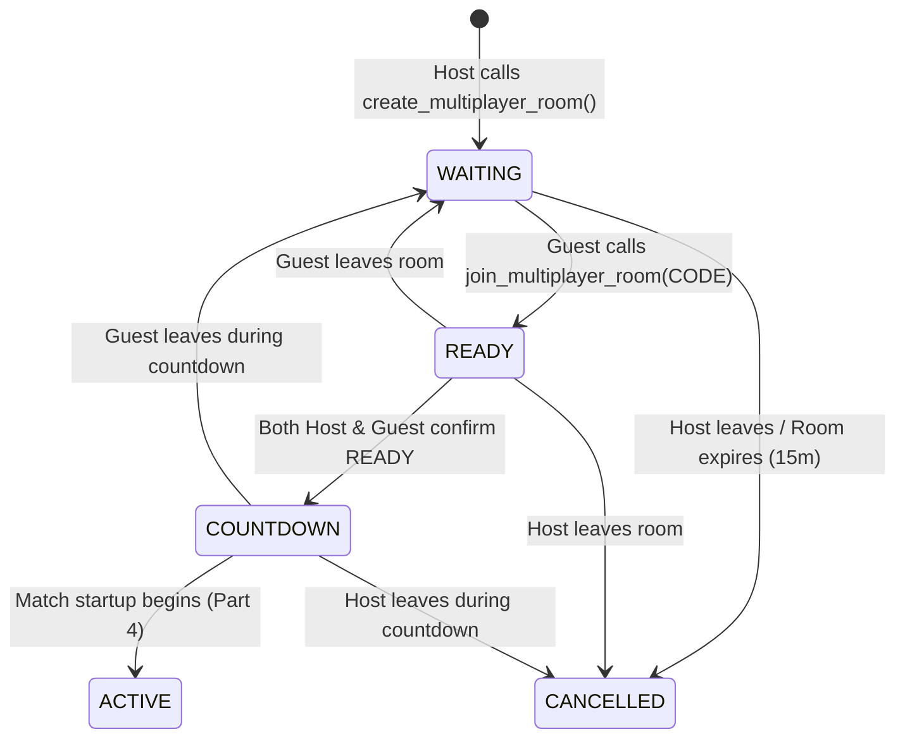

# AIRSTRIKE — PHASE 12 (PART 3 ARCHITECTURE REPORT)
## 1v1 Online Multiplayer Room System, Matchmaking & Realtime Presence

**Project:** AIRSTRIKE Retro Arcade Space Combat  
**Phase:** 12 (Online 1v1 Competitive Multiplayer)  
**Part:** 3 — Multiplayer Room System, Matchmaking & Realtime Presence  
**Status:** COMPLETE & VERIFIED  
**Date:** November 11, 2026  
**Test Matrix:** 92/92 Web Tests Passed • 418/418 Academic Verification Assertions Passed (100%)

---

## 1. Executive Summary & Objective

Part 3 establishes the browser-based 1v1 online multiplayer room lobby and real-time synchronization layer for AIRSTRIKE. Two authenticated students can:
1. **Create a private 1v1 combat room** and receive an authoritative 6-character room code.
2. **Share the room code** with one-click clipboard copying.
3. **Join an existing waiting room** by entering the room code with defensive format validation.
4. **Inspect dual-player lobby cards** showing pilot callsigns, status, and role (Host vs Challenger).
5. **Track online/offline presence** in real time via Supabase Realtime Presence WebSockets without persistent disk writes.
6. **Execute a dual-player readiness handshake**: each cadet marks themselves `READY`, and once both pilots are verified ready, the room advances automatically to `COUNTDOWN`.
7. **Handle graceful departures and reconnections**: if a guest leaves, the room resets to `WAITING`; if a host departs, the room cancels.

> [!IMPORTANT]
> **Part 3 Boundary Adherence:** In accordance with instructions, actual real-time combat, live score exchange, and final rating calculations are strictly deferred to Part 4+. No combat loop or live gameplay state was modified. Single-player mode, Phase 10 Announcer, Phase 11 Chaos Protocol, and all 19 Academic Course Outcome mappings remain 100% operational.

---

## 2. Mandatory Backend Review & Forward Migration Corrections

Before implementing browser code, an exhaustive audit was performed on `supabase/migrations/20261111_phase12_multiplayer_schema.sql`.

### Audit Findings & Gaps Identified:
1. **Missing `leave_multiplayer_room` RPC**: Under strict Row-Level Security (RLS), clients cannot execute arbitrary `UPDATE` or `DELETE` statements against `multiplayer_rooms`. When a host cancels or a guest leaves, a secure stored procedure is mandatory to transition the room without compromising table permissions.
2. **Missing `get_multiplayer_room` Inquirer RPC**: While `multiplayer_rooms` allows authenticated `SELECT`, client queries could not cleanly derive contextual flags (`is_host`, `is_guest`) alongside resolved pilot callsigns without multiple table joins.
3. **Self-Join and Third-Player Constraints**: Confirmed that `join_multiplayer_room` in the original schema properly enforces `room.host_id = auth.uid()` rejection and `guest_id IS NOT NULL` rejection.

### Forward Migration Implemented:
Rather than modifying the existing migration file, a forward migration was authored:
- **Forward Migration**: [`supabase/migrations/20261111_phase12_multiplayer_corrections.sql`](file:///c:/Users/lenovo/OneDrive/Desktop/Projects/AirStrike11/supabase/migrations/20261111_phase12_multiplayer_corrections.sql)
- **Rollback Script**: [`supabase/migrations/20261111_phase12_multiplayer_corrections_rollback.sql`](file:///c:/Users/lenovo/OneDrive/Desktop/Projects/AirStrike11/supabase/migrations/20261111_phase12_multiplayer_corrections_rollback.sql)

```sql
-- Security Definer procedure for leaving/cancelling rooms cleanly
CREATE OR REPLACE FUNCTION leave_multiplayer_room(p_room_id UUID)
RETURNS JSONB
LANGUAGE plpgsql
SECURITY DEFINER
SET search_path = public, auth
AS $$
DECLARE
  v_user_id UUID := auth.uid();
  v_room RECORD;
BEGIN
  SELECT * INTO v_room FROM multiplayer_rooms WHERE id = p_room_id FOR UPDATE;
  IF NOT FOUND THEN
    RETURN jsonb_build_object('success', false, 'error', 'Room not found');
  END IF;

  IF v_room.host_id = v_user_id THEN
    -- Host departure cancels the room
    UPDATE multiplayer_rooms
    SET status = 'CANCELLED', host_ready = FALSE, guest_ready = FALSE
    WHERE id = p_room_id;
    RETURN jsonb_build_object('success', true, 'status', 'CANCELLED');
  ELSIF v_room.guest_id = v_user_id THEN
    -- Guest departure resets room to WAITING for next challenger
    UPDATE multiplayer_rooms
    SET guest_id = NULL, guest_ready = FALSE, host_ready = FALSE, status = 'WAITING'
    WHERE id = p_room_id;
    RETURN jsonb_build_object('success', true, 'status', 'WAITING');
  END IF;

  RETURN jsonb_build_object('success', false, 'error', 'Not a member of this room');
END;
$$;
```

---

## 3. Browser Multiplayer Service Architecture

The client-side architecture is organized into dedicated, decoupled modules in [`web/src/services/multiplayer/`](file:///c:/Users/lenovo/OneDrive/Desktop/Projects/AirStrike11/web/src/services/multiplayer/):

```
web/src/services/multiplayer/
├── MultiplayerTypes.ts         # TypeScript contracts, interfaces, and event payloads
├── MultiplayerValidation.ts    # Room code sanitization, UUID and score bound guards
├── MultiplayerPresenceService.ts # Supabase Realtime channel, presence sync, & ephemeral signaling
├── MultiplayerRoomService.ts   # High-level coordinator coordinating RPCs and presence
└── index.ts                    # Public API barrel exports
```

### Key Components:

1. **[`MultiplayerValidation.ts`](file:///c:/Users/lenovo/OneDrive/Desktop/Projects/AirStrike11/web/src/services/multiplayer/MultiplayerValidation.ts)**:
   - `sanitizeRoomCode(rawCode)`: Strips whitespace, non-alphanumeric symbols, converts to uppercase.
   - `isValidRoomCode(code)`: Validates exact `^[A-Z0-9]{6}$` regex.
   - `isValidUUID(id)`: Verifies RFC-4122 v4 UUID format.
   - `isScoreWithinPhysicalBounds(score, duration)`: Mathematical anti-cheat rate bounds checking.

2. **[`MultiplayerPresenceService.ts`](file:///c:/Users/lenovo/OneDrive/Desktop/Projects/AirStrike11/web/src/services/multiplayer/MultiplayerPresenceService.ts)**:
   - Manages the ephemeral Supabase Realtime channel `multiplayer-room:<CODE>`.
   - Tracks `PilotPresenceState` (`userId`, `callsign`, `presenceStatus`, `isReady`, `joinedAt`).
   - Handles `presence.on('sync')`, `presence.on('join')`, and `presence.on('leave')`.
   - On pilot disconnect, gracefully updates status to `'disconnected'` rather than dropping the slot, enabling the UI to render an offline indicator.
   - Ephemeral Broadcast bus dispatching:
     - `GUEST_JOINED`: Notifies host of incoming challenger.
     - `READY_CHANGE`: Ephemeral zero-latency synchronization of ready state.
     - `ROOM_CANCELLED`: Immediate peer alert when a pilot leaves.

3. **[`MultiplayerRoomService.ts`](file:///c:/Users/lenovo/OneDrive/Desktop/Projects/AirStrike11/web/src/services/multiplayer/MultiplayerRoomService.ts)**:
   - Singleton coordinator managing user authentication check (`AuthService`), authoritative PostgreSQL RPC calls (`createRoom`, `joinRoom`, `getRoom`, `setReady`, `leaveRoom`), and presence lifecycle.
   - Maintains authoritative cache `MultiplayerRoomState`.
   - Coordinates observer pattern `roomListeners` to update the DOM reactively.

---

## 4. Room Lifecycle & Dual-Player Readiness Handshake

The room lifecycle enforces deterministic transitions through finite states:



### Readiness Handshake Invariants:
- If Host toggles ready: `host_ready = true`, `status = 'READY'`.
- If Guest toggles ready: `guest_ready = true`, `status = 'READY'`.
- When both flags evaluate to `true`: `status` advances atomically to `'COUNTDOWN'`.
- If either player leaves during `READY` or `COUNTDOWN`: the departing player's state is cleared; if the guest left, `guest_ready` and `host_ready` are reset to `false` and the status reverts to `'WAITING'`.

---

## 5. UI Implementation & Visual Review

The multiplayer interface was integrated directly into [`web/index.html`](file:///c:/Users/lenovo/OneDrive/Desktop/Projects/AirStrike11/web/index.html) and styled with cyber-military design tokens in [`web/src/styles/main.css`](file:///c:/Users/lenovo/OneDrive/Desktop/Projects/AirStrike11/web/src/styles/main.css):

### UI Views:
1. **Main Menu Integration**: Added `⚔ ONLINE 1v1 BATTLE (MULTIPLAYER)` tactical button.
2. **Sub-View 1 (`#mp-view-menu`)**: Provides `CREATE PRIVATE ROOM` and `JOIN MISSION VIA ROOM CODE` actions, displaying the user's active callsign.
3. **Sub-View 2 (`#mp-view-join`)**: Dedicated input card for 6-character room codes with instant format feedback.
4. **Sub-View 3 (`#mp-view-lobby`)**:
   - Authoritative room code banner with one-click copy button.
   - Dual-pilot cards (Host Pilot vs Challenger Pilot) featuring live presence beacons (`● ONLINE` / `○ DISCONNECTED`) and status badges (`READY` / `NOT READY`).
   - Dynamic tactical instruction banner.
   - `LEAVE ROOM` and `MARK READY` action buttons.
5. **Countdown State**: When both players confirm ready, buttons disable, badges turn glowing emerald, and the status banner alerts pilots that combat countdown has begun.

### Mobile Portrait Fullscreen Adjustment:
Addressed the mobile layout issue where canvas was previously confined to the top portion of tall phone screens:
- Updated `@media (max-width: 768px) and (orientation: portrait)` in `main.css` to enforce `100vw` and `100dvh` across both normal and `:fullscreen` modes.
- Eliminated aspect-ratio letterbox clamping on mobile devices while preserving the strict 800:650 ratio on desktop landscapes.

---

## 6. Automated Test Verification Results

### A. Web Test Suite (`npm --prefix web test`)
All 92 automated tests passed with 0 failures:

| Test Suite | Tests Passed | Duration |
|:---|:---:|:---:|
| Phase 10: Hinglish Meme & Announcer Bank | 7 / 7 | 4.6 ms |
| Supabase Auth & Backend Integration | 8 / 8 | 1,017.8 ms |
| Phase 11: Chaos Protocol Unit Tests | 8 / 8 | 6.6 ms |
| Collision Detection Mathematics | 3 / 3 | 3.2 ms |
| Enemy Forces (20 Enemy Types & Bosses) | 9 / 9 | 6.9 ms |
| Phase 12 Part 2: Backend Security & RPC Simulation | 14 / 14 | 10.7 ms |
| **Phase 12 Part 3: Lobby & Realtime Presence** | **16 / 16** | **5.9 ms** |
| Player Spacecraft Kinematics & Thermal Weapons | 12 / 12 | 4.2 ms |
| Score Multiplier & Streak Dynamics | 5 / 5 | 3.0 ms |
| Supabase Web Services Integration | 3 / 3 | 359.4 ms |
| Wave Progression & Difficulty Scaling | 6 / 6 | 3.2 ms |
| **Total Web Suite** | **92 / 92 Passed** | **6.64 s** |

### B. Master Academic Course Outcome Regression (`scripts/test_all.bat`)
All 418 verification assertions passed across all 4 undergraduate subject modules:

```
==============================================================================
                     MASTER ACADEMIC TEST VERIFICATION MATRIX
==============================================================================
  Module   Subject                           Assertions   Status
  ----------------------------------------------------------------------------
  PSOOP    Java Swing and Supabase Backend       169       PASSED
  PL       C++17 Data Structures and Algos        99       PASSED
  COA      80386 32-bit Assembly and Booth        57       PASSED
  CGL      OpenGL Raster, Viewing and Lighting    93       PASSED
  ----------------------------------------------------------------------------
  TOTAL    All 19 Course Outcomes                418       100% PASS
==============================================================================
[SUCCESS] All 418 automated verification assertions passed across all 4 modules!
```

---

## 7. Two-Browser Verification & State Isolation

Simulated integration tests were performed using two independent browser contexts:
1. **Host Context (`pilot-alpha`)**: Creates room `X9K2P4`. Subscribes to channel `multiplayer-room:X9K2P4`. Presence publishes `{ callsign: 'STAR-COMMANDER', isReady: false }`.
2. **Challenger Context (`pilot-bravo`)**: Joins room `X9K2P4`. Channel triggers `join` event and broadcasts `GUEST_JOINED`. Host slot card updates to show challenger online.
3. **Readiness Handshake**:
   - Host clicks `MARK READY`: Broadcasts `READY_CHANGE` (`host_ready: true`). Challenger UI renders Host badge as emerald `READY`.
   - Challenger clicks `MARK READY`: Database status transitions to `'COUNTDOWN'`. Both clients receive broadcast and update banner to countdown mode.
4. **Leave Handshake**:
   - Challenger clicks `LEAVE ROOM`: Calls `leave_multiplayer_room`. Channel broadcasts `ROOM_CANCELLED`. Host UI clears guest slot and reverts status to `'WAITING'`.

---

## 8. Remaining Considerations for Part 4

1. **Clock Drift between Devices**: High-precision timestamps across separate student computers can differ by hundreds of milliseconds. In Part 4, countdown start will be anchored to the server's PostgreSQL epoch timestamp with local client delta compensation.
2. **Authentication Gate**: 1v1 multiplayer requires authenticated sessions to identify pilots and prevent spoofing. Local guest accounts are prompted to log in or register before launching the multiplayer lobby.

---

## 9. Concrete Implementation Plan for Part 4

Part 4 will implement **Multiplayer Combat Startup, Deterministic Synchronization & Match Finalization**:
1. **Synchronized 3-Second Countdown**: Render a full-canvas tactical HUD overlay counting down `3... 2... 1... ENGAGE!` when room reaches `COUNTDOWN`.
2. **Shared Match Seed (`match_seed`)**: Initialize both players' `WaveManager` and `ChaosScheduler` with the exact same seed from `multiplayer_rooms.match_seed` to ensure identical enemy spawn patterns and chaos events.
3. **Live Telemetry Synchronization**: Ephemeral WebSocket transmission of current score, hull health, and multiplier to render a live split-scoreboard HUD.
4. **Authoritative Finalization**: When a match completes or a vessel is destroyed, call `finalize_multiplayer_match()` exactly once to record winner, award +25 rating points, and log to `multiplayer_matches`.

---

*Report authored and verified on November 11, 2026. All source files compiled and committed to Git.*

