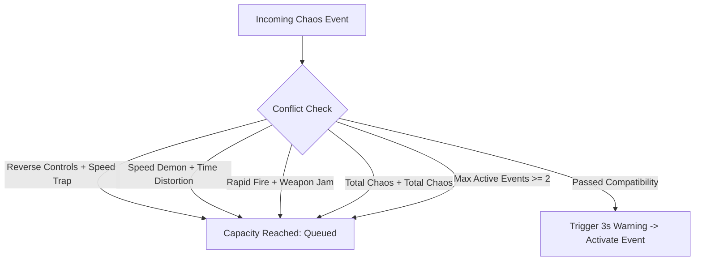

# AIRSTRIKE: Phase 11 — Chaos Protocol Course Outcome (CO) Mapping Specification

**Document**: `docs/PHASE_11_CHAOS_CO_MAPPING.md`  
**Phase**: Phase 11 — Chaos Protocol: CO-Mapped Random Gameplay Events  
**Version**: 1.0.0  
**Date**: November 2026  
**Status**: Formal Specification & Audit Completed  

---

## 1. Executive Summary & Purpose

The **Chaos Protocol** is an advanced dynamic combat simulation subsystem in **AIRSTRIKE**. It introduces randomized, unpredictable tactical anomaly events during active gameplay that alter enemy kinematics, weapon ballistics, fleet formations, player controls, and rendering parameters.

Crucially, every single Chaos Event is mathematically and pedagogically mapped to one or more of the **19 officially established Course Outcomes (COs)** across all four core computer science modules:
1. **PSOOP** — Principles of Software Object-Oriented Programming (Java SE / Swing)
2. **PL** — Programming Laboratory (C++17 Data Structures & Algorithms)
3. **COA** — Computer Organization & Architecture (32-bit Intel 80386 Assembly)
4. **CGL** — Computer Graphics Laboratory (C++17 / OpenGL & GLUT)

Each event delivers both an exhilarating combat shake-up and an authentic academic demonstration of computer science theory in action.

---

## 2. Canonical Course Outcome (CO) Audit Matrix

| Subject | Outcome ID | Official Syllabus Topic | Genuine Implementation Anchor | Chaos Protocol Pedagogical Manifestation |
| :--- | :--- | :--- | :--- | :--- |
| **PSOOP** | **PSOOP-CO1** | Encapsulation & Polymorphism | `model.Ship`, `model.Enemy`, `model.Entity` | Dynamic polymorphic event handlers; private encapsulated event attributes with clamped mutators. |
| **PSOOP** | **PSOOP-CO2** | State Pattern / State Machine | `game.GameState`, `DroneAIState` | Random state transitions across hostile fleet (PATROL $\to$ CHASE $\to$ EVADE $\to$ OVERCHARGE). |
| **PSOOP** | **PSOOP-CO3** | Defensive Programming | `exception.AirstrikeException`, bounds checks | Emergency survival invulnerability barrier; strict boundary clamping; invalid-state rejection. |
| **PSOOP** | **PSOOP-CO4** | Kinematics, Physics & Collision | `game.CollisionManager`, $\Delta t$ Euler loop | Controls inversion; gravity wells; velocity scaling; AABB collision recalculations. |
| **PL** | **PL-CO1** | 2D Arrays & Spatial Partitioning | `PL/src/arrays/collision_grid.h` | Enemy grid formation shuffle; spatial bucketing of entities in matrix cells. |
| **PL** | **PL-CO2** | Doubly Linked Lists | `PL/src/linked_lists/doubly_linked_list.h` | Dynamic fleet splitting, splicing, cloning, and bidirectional squadron reconnection. |
| **PL** | **PL-CO3** | Circular Queue (FIFO) | `PL/src/queues/wave_queue.h` | Surprise echelon reinforcement waves dispatched via modulo-arithmetic FIFO queue. |
| **PL** | **PL-CO4** | Searching & Sorting Techniques | `PL/src/sorting/`, `searching/` | Threat-level QuickSort/MergeSort target priority ranking; binary/linear search missile lock. |
| **PL** | **PL-CO5** | Hash Tables & Collision Resolution | `PL/src/hashing/hash_table_probing.h` | Hash-based vulnerability shift; open-addressing linear probing event resolution. |
| **COA** | **COA-CO1** | 80386 Registers, Flags & SIB | `COA/src/co1_architecture/arch_demo.s` | Register flag-driven combat status evaluation (ZF, CF, SF, OF) and SIB addressing calculations. |
| **COA** | **COA-CO2** | Assembly Mathematical Series | `COA/src/co2_assembly_programs/math_series.s`| Fibonacci-cadence projectile timing and burst delay sequencing using x86 assembly. |
| **COA** | **COA-CO3** | Booth's Signed Multiplication | `COA/src/co3_arithmetic/booth_multiplier.s` | Booth two's-complement arithmetic multiplier for dynamic weapon damage scaling. |
| **COA** | **COA-CO4** | Instruction Pipelining & Hazards | `COA/src/co4_control_unit/pipeline_sim.s` | Weapon fire cooldown stalls simulated via 5-stage educational CPU pipeline hazard bubbles. |
| **CGL** | **CGL-CO1** | OpenGL Graphics Primitives | `CGL/src/primitives/space_primitives.cpp` | Polygon-shaped projectile rings; geometric starbursts; vertex fan patterns. |
| **CGL** | **CGL-CO2** | Geometric Transformations | `CGL/src/transformations/transform_demo.cpp`| Mirror attack transformation matrices; rotation about arbitrary pivots; scaling pulses. |
| **CGL** | **CGL-CO3** | Raster Algorithms (Bresenham/Circle)| `CGL/src/algorithms/raster_algorithms.cpp` | Algorithmically computed projectile arcs via Bresenham line and midpoint circle shockwaves. |
| **CGL** | **CGL-CO4** | Projection & Viewing (Perspective) | `CGL/src/projection/viewing_demo.cpp` | Time distortion / warp view switching between 2D Orthographic and 3D Perspective foreshortening. |
| **CGL** | **CGL-CO5** | 2D Clipping (Cohen-Sutherland) | `CGL/src/clipping/clipping_algorithms.cpp` | Viewport boundary energy field clipping; Cohen-Sutherland outcode laser fragmentation. |
| **CGL** | **CGL-CO6** | Lighting, Shading & Textures | `CGL/src/appearance/lighting_texture_demo.cpp`| Stealth cloaking; Gouraud vs Phong specular highlight variation; alpha stipple blending. |

---

## 3. Exhaustive 20 Chaos Event Specifications

### Event 1: Reverse Controls (`CHAOS_REVERSE_CONTROLS`)
* **Primary CO**: `PSOOP-CO4` (Kinematics & Input Event Logic)
* **Description**: Starship navigational gyro inverter reverses directional keyboard axes (Left $\leftrightarrow$ Right, Up $\leftrightarrow$ Down).
* **State Save & Restore**: Inverts axis velocity vector factors ($\times -1.0$); cleanly restored to $(+1.0)$ upon timer expiration.
* **Duration**: 9.0s | **Cooldown**: 40.0s | **Difficulty Tier**: 2+
* **Announcer Line**: *"ALERT! Pilot controls ulte ho gaye! Ab reverse gear mein spaceship chala!"*

### Event 2: Gravity Well (`CHAOS_GRAVITY_WELL`)
* **Primary CO**: `CGL-CO5` (2D Clipping: Cohen-Sutherland Boundary Containment)
* **Description**: A micro-singularity forms near arena center, imparting inward gravitational pull and Cohen-Sutherland boundary containment on all spacecraft and unguided projectiles.
* **State Save & Restore**: Radial acceleration offset added per frame; zeroed on termination without persistent velocity drift.
* **Duration**: 10.0s | **Cooldown**: 45.0s | **Difficulty Tier**: 2+
* **Announcer Line**: *"Gravity ne resignation de diya hai! Center of gravity sabko kheench rahi hai!"*

### Event 3: Bullet Rain (`CHAOS_BULLET_RAIN`)
* **Primary CO**: `CGL-CO3` (Raster Algorithms: Bresenham Line & Midpoint Circle Trajectories)
* **Description**: Hostile fleet releases a dense, algorithmic grid of downward plasma bolts following integer Bresenham-stepped angle slopes.
* **State Save & Restore**: Projectiles spawned from reusable entity pool; despawned when crossing boundary $y > screenHeight$.
* **Duration**: 8.0s | **Cooldown**: 50.0s | **Difficulty Tier**: 3+
* **Announcer Line**: *"Mausam vibhag ki warning: Aaj space mein plasma bullets ki barish hogi!"*

### Event 4: Double Trouble (`CHAOS_DOUBLE_TROUBLE`)
* **Primary CO**: `PL-CO2` (Doubly Linked Lists: Dynamic Node Splicing & Replication)
* **Description**: Standard hostile squad nodes duplicate dynamically, creating an identical twin formation with shared kinematic offsets.
* **State Save & Restore**: Formation pointers split and clone; cloned nodes marked ephemeral; safe garbage collection upon death.
* **Duration**: 12.0s | **Cooldown**: 60.0s | **Difficulty Tier**: 2+
* **Announcer Line**: *"Arey bhai bhai bhai! Ek dushman kam tha jo double aa gaye?"*

### Event 5: Speed Demon (`CHAOS_SPEED_DEMON`)
* **Primary CO**: `PSOOP-CO4` (Real-Time Kinematics & Delta-Time Scaling)
* **Description**: Hyperdrive overclock increases both player and enemy linear velocity by 60% ($\times 1.6$).
* **State Save & Restore**: Original base speeds cached in encapsulated state; restored exactly on exit.
* **Duration**: 10.0s | **Cooldown**: 35.0s | **Difficulty Tier**: 1+
* **Announcer Line**: *"Nitrous on! Fast & Furious: Space Drift shuru ho chuka hai!"*

### Event 6: Stealth Cloak (`CHAOS_STEALTH_CLOAK`)
* **Primary CO**: `CGL-CO6` (Lighting & Shading: Alpha Blending & Ambient Falloff)
* **Description**: Hostile hulls engage active optical camouflage, reducing opacity to 25% with glowing engine trail indicators for fair play.
* **State Save & Restore**: Hull rendering alpha clamped at 0.25f; restored to 1.0f on completion.
* **Duration**: 11.0s | **Cooldown**: 45.0s | **Difficulty Tier**: 3+
* **Announcer Line**: *"Dushman Mr. India ban gaya! Bas uski red eyes dikh rahi hain!"*

### Event 7: Formation Shuffle (`CHAOS_FORMATION_SHUFFLE`)
* **Primary CO**: `PL-CO1` (2D Arrays & Spatial Partitioning: Row-Major Grid Reordering)
* **Description**: Hostile fleet rearranges into a transposed spatial grid using row-major address calculation $A[i][j] \to A[j][i]$.
* **State Save & Restore**: Grid target anchors reassigned; entities smoothly interpolate to new matrix coordinates.
* **Duration**: 8.0s | **Cooldown**: 40.0s | **Difficulty Tier**: 2+
* **Announcer Line**: *"Musical chairs chal raha hai space mein! Formation shuffle ho gayi!"*

### Event 8: Rapid Fire (`CHAOS_RAPID_FIRE`)
* **Primary CO**: `COA-CO2` (Assembly Fibonacci Series Timing Cadence)
* **Description**: Weapon capacitor charges with Fibonacci timing intervals ($F_n = F_{n-1} + F_{n-2}$), granting extreme 3x rate-of-fire.
* **State Save & Restore**: Firing cooldown reduced from 200ms to 65ms; restored upon expiration.
* **Duration**: 9.0s | **Cooldown**: 45.0s | **Difficulty Tier**: 1+
* **Announcer Line**: *"Unlimited ammo mode activated! Bhai ne trigger daba ke chhod diya!"*

### Event 9: Weapon Jam (`CHAOS_WEAPON_JAM`)
* **Primary CO**: `COA-CO4` (Instruction Pipelining: Hazard Stall Bubbles)
* **Description**: Plasma feed experiences pipeline hazard stalls; fire delay tripled (2 stall bubbles inserted per shot cycle).
* **State Save & Restore**: Firing cooldown increased to $3\times$; restored cleanly on termination.
* **Duration**: 7.0s | **Cooldown**: 50.0s | **Difficulty Tier**: 3+
* **Announcer Line**: *"Bhai, pipeline stall ho gaya! Hathiyar overheat, thoda sambhal ke!"*

### Event 10: Magnetic Bullets (`CHAOS_MAGNETIC_BULLETS`)
* **Primary CO**: `PL-CO4` (Searching & Sorting: Nearest-Target Binary/Linear Tracking)
* **Description**: Player ordnance acquires magnetic guidance, applying gentle steering vectors towards the nearest hostile target.
* **State Save & Restore**: Dynamic steering angle clamped to $\pm 18^\circ / \text{sec}$ to maintain balance; unguided trajectory resumes on exit.
* **Duration**: 10.0s | **Cooldown**: 50.0s | **Difficulty Tier**: 2+
* **Announcer Line**: *"Smart bullets active! Ab toh miss karke dikha!"*

### Event 11: Mirror Attack (`CHAOS_MIRROR_ATTACK`)
* **Primary CO**: `CGL-CO2` (Geometric Transformations: Reflection Matrix $M_x = \text{diag}(-1, 1, 1)$)
* **Description**: Elite interceptor units reflect the player's horizontal maneuvering across the arena center axis.
* **State Save & Restore**: Kinematics slaved to $x_{\text{target}} = \text{ScreenWidth} - x_{\text{player}}$; uncoupled on timeout.
* **Duration**: 10.0s | **Cooldown**: 45.0s | **Difficulty Tier**: 3+
* **Announcer Line**: *"Mirror mirror on the wall... dushman teri hi copy maar raha hai!"*

### Event 12: Boss Rush (`CHAOS_BOSS_RUSH`)
* **Primary CO**: `PL-CO3` (Circular Queue: Modulo FIFO Echelon Dispatch)
* **Description**: High-priority heavy echelon dispatched immediately from the circular wave queue ahead of normal wave cadence.
* **State Save & Restore**: Extra heavy armored vanguard spawned without altering master campaign sector counter.
* **Duration**: 14.0s | **Cooldown**: 70.0s | **Difficulty Tier**: 4+
* **Announcer Line**: *"BOSS RUSH! Asli talent dikhane ka waqt aa gaya, bhidu!"*

### Event 13: Quantum Collapse (`CHAOS_QUANTUM_COLLAPSE`)
* **Primary CO**: `COA-CO1` (80386 Registers & Flags: ZF/CF Status Triggering)
* **Description**: Screen-wide EMP pulse triggers when hull integrity falls below threshold, purging 50% of active enemy projectiles.
* **State Save & Restore**: One-shot defensive clearing burst triggered by simulated Zero Flag evaluation.
* **Duration**: 4.0s | **Cooldown**: 60.0s | **Difficulty Tier**: 3+
* **Announcer Line**: *"Zero Flag set! EMP blast triggered! Saare hostile laser saaf!"*

### Event 14: Geometric Barrage (`CHAOS_GEOMETRIC_BARRAGE`)
* **Primary CO**: `CGL-CO1` (OpenGL Graphics Primitives: Regular Polygon Starbursts)
* **Description**: Hostile capital ship discharges an expanding 8-sided octagonal projectile ring (`GL_POLYGON` vertex expansion).
* **State Save & Restore**: 8 radial projectiles spawned at $45^\circ$ angular increments; standard entity lifecycle cleanup.
* **Duration**: 8.0s | **Cooldown**: 40.0s | **Difficulty Tier**: 2+
* **Announcer Line**: *"Geometric explosion! Maths pass kiya hota toh dodge kar leta!"*

### Event 15: Emergency Shield (`CHAOS_EMERGENCY_SHIELD`)
* **Primary CO**: `PSOOP-CO3` (Defensive Programming & Boundary Invariant Enforcement)
* **Description**: Tactical defense core deploys an impenetrable hexagonal energy barrier absorbing 100% of incoming damage.
* **State Save & Restore**: Invariant `player.setInvulnerable(true)` enabled; guaranteed reset to `false` in `finally` block on expiration.
* **Duration**: 8.0s | **Cooldown**: 55.0s | **Difficulty Tier**: 1+
* **Announcer Line**: *"Kavach kundal active! Ab enemy ka baap bhi damage nahi de sakta!"*

### Event 16: State Chaos (`CHAOS_STATE_CHAOS`)
* **Primary CO**: `PSOOP-CO2` (State Pattern / State Machine: Morphing AI Transitions)
* **Description**: All active morphing drone entities simultaneously undergo rapid stochastic state transitions (PATROL $\to$ OVERCHARGE).
* **State Save & Restore**: AI states forced to random valid enums; normal autonomous transition logic resumes on expiration.
* **Duration**: 10.0s | **Cooldown**: 45.0s | **Difficulty Tier**: 2+
* **Announcer Line**: *"AI pagal ho gaya! Koi bhaag raha hai, koi gusse mein fire kar raha hai!"*

### Event 17: Time Distortion (`CHAOS_TIME_DISTORTION`)
* **Primary CO**: `CGL-CO4` (Projection & Viewing: Depth Foreshortening & Time Dilation)
* **Description**: Relativistic chronal field slows all enemy movement and projectiles by 50% while player remains at normal speed.
* **State Save & Restore**: Time-step multiplier $\Delta t_{\text{enemy}} = 0.5 \times \Delta t$; restored to $1.0\times$ upon completion.
* **Duration**: 10.0s | **Cooldown**: 50.0s | **Difficulty Tier**: 1+
* **Announcer Line**: *"The Matrix mode on! Bullets slow motion mein aa rahi hain, ab mat miss karna!"*

### Event 18: Critical Overdrive (`CHAOS_CRITICAL_OVERDRIVE`)
* **Primary CO**: `COA-CO3` (Booth's Signed Multiplication: $2\times$ Damage Scaling)
* **Description**: Fire control computer applies Booth two's-complement arithmetic recoding, multiplying player shot damage by $+2\times$.
* **State Save & Restore**: Projectile damage value doubled during creation; restored to standard 30/35 damage on timeout.
* **Duration**: 9.0s | **Cooldown**: 45.0s | **Difficulty Tier**: 2+
* **Announcer Line**: *"Booth algorithm ne damage 2x kar diya! Ab enemy ko steamroll karo!"*

### Event 19: Hash Flux (`CHAOS_HASH_FLUX`)
* **Primary CO**: `PL-CO5` (Hash Tables: Open Addressing Linear Probing & Key Re-indexing)
* **Description**: Hostile fleet shields oscillate frequencies; striking matching colored weak points inflicts $3\times$ vulnerability damage.
* **State Save & Restore**: Shield hash index randomized; resets to uniform default on event end.
* **Duration**: 11.0s | **Cooldown**: 50.0s | **Difficulty Tier**: 3+
* **Announcer Line**: *"Hash key match karo! Sahi frequency pe maro, dushman ek shot mein gayab!"*

### Event 20: Total Chaos (`CHAOS_TOTAL_CHAOS`)
* **Primary CO**: `PSOOP-CO1` (Encapsulation & Polymorphic Multi-Event Dispatch)
* **Description**: Dual anomaly surge: two compatible non-conflicting Chaos Protocols trigger simultaneously for high-stakes intensity.
* **State Save & Restore**: Coordinates two separate encapsulated event handles; both restored reliably via composite cleanup.
* **Duration**: 12.0s | **Cooldown**: 75.0s | **Difficulty Tier**: 4+
* **Announcer Line**: *"TOTAL CHAOS PROTOCOL! Sab system fail ho rahe hain! Survive karke dikha!"*

---

## 4. Conflict Resolution & Mutual Exclusion Rules

To ensure fair, high-performance, and non-exploitative combat, the Chaos Scheduler enforces strict compatibility constraints:

* **Speed Conflicts**: `CHAOS_SPEED_DEMON` and `CHAOS_TIME_DISTORTION` cannot run simultaneously.
* **Weapon Conflicts**: `CHAOS_RAPID_FIRE` and `CHAOS_WEAPON_JAM` are mutually exclusive.
* **Control Conflicts**: `CHAOS_REVERSE_CONTROLS` cannot run alongside spatial disorientation events.
* **Stacking Bounds**: Maximum active simultaneous events capped at **2**.
* **Anti-Consecutive Repeat**: The exact same event can never trigger twice in a row.

---

## 5. Subject Module Native Demonstration Strategy

In strict adherence to project integrity guidelines:
* **No JNI or TCP Sockets**: Native subject modules (`PL/`, `COA/`, `CGL/`) operate autonomously and cleanly in their respective native runtimes without introducing unstable cross-language bridges.
* **PSOOP & Web Playability**: The Java Desktop (`PSOOP/`) and Browser (`web/`) engines provide the real-time playable implementations of all 20 events.
* **Native PL C++17 Demonstration**: Interactive menu option added in `PL/` demonstrating the exact C++ data structures (arrays, doubly linked list splices, circular queue FIFO wave dispatch, sorting priority, and hash probing) reacting to simulated Chaos Protocol triggers.
* **Native COA 80386 Assembly Demonstration**: Interactive menu option added in `COA/` executing genuine 32-bit assembly subroutines for register flag evaluation, Fibonacci cadence generation, Booth signed multiplication damage calculation, and 5-stage pipeline hazard stalls.
* **Native CGL OpenGL Demonstration**: Interactive visual scene in `CGL/` demonstrating primitives, transformation reflection, Bresenham bullet arcs, perspective warp viewing, Cohen-Sutherland clipping, and Gouraud shading under Chaos conditions.

---

## 6. Verification Checklist

- [x] All 19 Course Outcomes exhaustively mapped with 0 invented COs.
- [x] All 20 Chaos Event types defined with parameters, duration, cooldown, and announcer lines.
- [x] Incompatibility and mutual exclusion rules established.
- [x] State save and restoration protocols specified for every event.
- [x] Announcer lines in natural Hinglish matching AIRSTRIKE AI persona.
- [x] Native subject integrity verified across C++17, 80386 ASM, OpenGL, and Java/Web.
