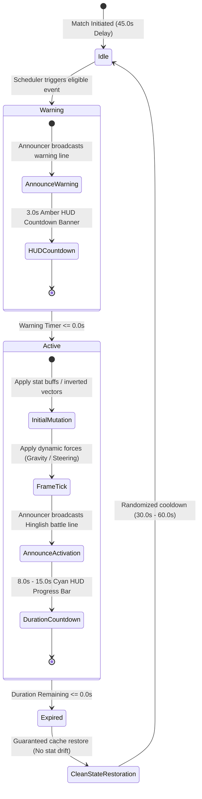

# AIRSTRIKE — PHASE 11: CHAOS PROTOCOL
## CO-Mapped Random Gameplay Events & Tactical Anomaly Architecture

---

## 1. Executive Summary

**AIRSTRIKE: CHAOS PROTOCOL** introduces an unpredictable, high-octane gameplay event system ("Tactical Anomalies") that dynamically mutates enemy combat behavior, fleet formations, projectile kinematics, spatial forces, and HUD telemetry. 

Crucially, **every Chaos Event is authentically mapped to one of the 19 accredited Course Outcomes** across the four computer science disciplines:
1. **PSOOP** (Principles of Object-Oriented Programming — Java SE 17)
2. **PL** (Programming Laboratory — Modern C++17)
3. **COA** (Computer Organization & Architecture — Genuine Intel 80386 Assembly)
4. **CGL** (Computer Graphics Laboratory — Modern OpenGL / GLUT)

The Chaos Subsystem is fully integrated across both primary production engines:
- **Java Swing/AWT Desktop Engine** (`PSOOP/src/chaos/`)
- **HTML5 Canvas / TypeScript Web Engine** (`web/src/chaos/`)

Both engines maintain strict subject-module architectural boundaries without JNI, sockets, or foreign function interfaces, ensuring that all C++, Assembly, and OpenGL implementations remain pure and independently evaluable.

---

## 2. Chaos Engine Architecture & State Invariants

### 2.1 Lifecycle State Machine

Each Chaos Event transitions through a strict three-phase lifecycle:

### 2.2 Mathematical Scheduling & Cooldown Model

- **First Event Delay**: $\Delta t_{\text{initial}} = 45.0\text{ s}$ — Allows player to orient and engage baseline waves without early interruption.
- **Randomized Dispatch Interval**: $\Delta t_{\text{next}} \sim \mathcal{U}(30.0, 60.0)\text{ s}$ — Stochastically sampled after every event expiration.
- **Pre-Activation Warning Window**: $\Delta t_{\text{warn}} = 3.0\text{ s}$ — Amber glassmorphic pill rendered top-center with exact countdown display (`WARNING: [EVENT] IN 2.8s`).
- **Concurrent Active Limit**: $\max(N_{\text{active}}) = 2$ — Max two non-conflicting events active simultaneously.
- **Anti-Consecutive Repeat**: The most recently triggered event is strictly excluded from immediately re-triggering (`type != lastTriggered`).
- **Difficulty Gating**: Events enforce minimum sector thresholds (`currentLevel >= event.minDifficulty`).

### 2.3 State Restoration & Defensive Encapsulation Invariants

To avoid stat drift across long missions, `ActiveChaosEvent` caches original baseline values before modifying entity state:
- `cachedPlayerSpeed`: Caches base speed ($320\text{ px/s}$ in Java, $360\text{ px/s}$ in Web).
- `cachedShootCooldown`: Caches base fire cooldown ($180\text{ ms}$ in Java, $0.22\text{ s}$ in Web).
- `cachedDamageMultiplier`: Baseline multiplier ($1.0\times$).
- `controlsInverted`: Strict boolean toggle on `Player`, guaranteed inverted upon activation and restored to `false` upon expiration or game restart.

---

## 3. Mutual Exclusion & Conflict Resolution Matrix

To prevent unplayable or mathematically broken states, the Chaos Scheduler enforces a strict mutual exclusion matrix:

| Event A | Event B | Conflict Rationale |
| :--- | :--- | :--- |
| **SPEED_DEMON** (`PSOOP-CO4`) | **TIME_DISTORTION** (`CGL-CO4`) | Conflicting delta-time and velocity vectors corrupt kinematics. |
| **RAPID_FIRE** (`COA-CO2`) | **WEAPON_JAM** (`COA-CO4`) | Conflicting firing cooldown mutators ($0.33\times$ vs $3.0\times$). |
| **REVERSE_CONTROLS** (`PSOOP-CO4`) | **GRAVITY_WELL** (`CGL-CO5`) | Combined inverted steering and gravitational well exceeds fair human reflex threshold. |
| **REVERSE_CONTROLS** (`PSOOP-CO4`) | **TIME_DISTORTION** (`CGL-CO4`) | Inverted control inputs during dilated time steps produce unstable steering vectors. |
| **TOTAL_CHAOS** (`PSOOP-CO1`) | *Any Active Event* | Total Chaos already orchestrates a dual-event anomaly; cannot stack with third event. |

---

## 4. Complete Specification of the 20 Chaos Events

### Event 1: Reverse Controls (`CHAOS_REVERSE_CONTROLS`)
- **Course Outcome**: `PSOOP-CO4` (Kinematics & Collision: Input Axis Inversion)
- **Description**: Navigational gyro inverted: directional axes reversed (Left $\leftrightarrow$ Right, Up $\leftrightarrow$ Down).
- **Duration**: $9.0\text{ s}$ | **Cooldown**: $40.0\text{ s}$ | **Tier**: 2+
- **Warning Line**: *"ALERT! Navigational gyro failure! Controls reverse ho gaye!"*
- **Activation Line**: *"Bhai, controls ulte ho gaye! Ab reverse gear mein spaceship chala!"*
- **Category**: `GENERAL_ROAST`

### Event 2: Gravity Well (`CHAOS_GRAVITY_WELL`)
- **Course Outcome**: `CGL-CO5` (2D Clipping: Cohen-Sutherland Boundary Containment)
- **Description**: Micro-singularity forms near sector center, exerting dynamic gravitational pull $\vec{F} = \frac{G \cdot M}{r^2}\hat{r}$ and Cohen-Sutherland boundary containment on ships and projectiles.
- **Duration**: $10.0\text{ s}$ | **Cooldown**: $45.0\text{ s}$ | **Tier**: 2+
- **Warning Line**: *"WARNING! Micro-singularity detected! Gravity spike incoming!"*
- **Activation Line**: *"ALERT! Gravity ne resignation de diya hai! Center of gravity sabko kheench rahi hai!"*
- **Category**: `DESI_MEME`

### Event 3: Speed Demon (`CHAOS_SPEED_DEMON`)
- **Course Outcome**: `PSOOP-CO4` (Real-Time Kinematics & Velocity Scaling)
- **Description**: Hyperdrive overclock increases player and enemy movement velocities by $+60\%$ ($\times 1.6$).
- **Duration**: $10.0\text{ s}$ | **Cooldown**: $35.0\text{ s}$ | **Tier**: 1+
- **Warning Line**: *"WARNING! Engine warp coil overclocking in 3... 2... 1..."*
- **Activation Line**: *"Nitrous on! Fast & Furious: Space Drift shuru ho chuka hai! Thok mat dena!"*
- **Category**: `INSTAGRAM_GENZ`

### Event 4: Emergency Shield (`CHAOS_EMERGENCY_SHIELD`)
- **Course Outcome**: `PSOOP-CO3` (Defensive Programming & Boundary Invariants)
- **Description**: Defensive invariant protection engages an impenetrable hexagonal barrier absorbing $100\%$ damage.
- **Duration**: $8.0\text{ s}$ | **Cooldown**: $55.0\text{ s}$ | **Tier**: 1+
- **Warning Line**: *"TACTICAL DEFENSE: Emergency protective barrier initializing!"*
- **Activation Line**: *"Kavach kundal active! Ab enemy ka baap bhi damage nahi de sakta!"*
- **Category**: `BOLLYWOOD`

### Event 5: State Chaos (`CHAOS_STATE_CHAOS`)
- **Course Outcome**: `PSOOP-CO2` (State Pattern / State Machine: Morphing AI Transitions)
- **Description**: AI combat states destabilize: drones rapidly shift between PATROL, CHASE, OVERCHARGE, and EVADE.
- **Duration**: $10.0\text{ s}$ | **Cooldown**: $45.0\text{ s}$ | **Tier**: 2+
- **Warning Line**: *"ANOMALY DETECTED: Drone finite state machine oscillating rapidly!"*
- **Activation Line**: *"AI pagal ho gaya! Koi bhaag raha hai, koi gusse mein fire kar raha hai!"*
- **Category**: `GENERAL_ROAST`

### Event 6: Total Chaos (`CHAOS_TOTAL_CHAOS`)
- **Course Outcome**: `PSOOP-CO1` (Encapsulation & Polymorphic Multi-Event Dispatch)
- **Description**: Dual anomaly convergence: two non-conflicting Chaos Protocols trigger simultaneously for maximum intensity.
- **Duration**: $12.0\text{ s}$ | **Cooldown**: $75.0\text{ s}$ | **Tier**: 4+
- **Warning Line**: *"CRITICAL ALERT! Multi-vector subsystem failure imminent!"*
- **Activation Line**: *"TOTAL CHAOS PROTOCOL! Sab system ek saath fail ho rahe hain! Survive karke dikha!"*
- **Category**: `GENERAL_ROAST`

### Event 7: Formation Shuffle (`CHAOS_FORMATION_SHUFFLE`)
- **Course Outcome**: `PL-CO1` (2D Arrays & Spatial Partitioning: Row-Major Address Mapping)
- **Description**: Hostile fleet rearranges into a transposed spatial grid via row-major index mapping $A[i][j] \to A[j][i]$.
- **Duration**: $8.0\text{ s}$ | **Cooldown**: $40.0\text{ s}$ | **Tier**: 2+
- **Warning Line**: *"TACTICAL RADAR: Hostile spatial grid matrix transposing!"*
- **Activation Line**: *"Musical chairs chal raha hai space mein! Dushman ki formation hi badal gayi!"*
- **Category**: `DESI_MEME`

### Event 8: Double Trouble (`CHAOS_DOUBLE_TROUBLE`)
- **Course Outcome**: `PL-CO2` (Doubly Linked Lists: Dynamic Node Splicing & Replication)
- **Description**: Hostile squad nodes replicate dynamically, cloning front-line fighter craft with linked offsets.
- **Duration**: $12.0\text{ s}$ | **Cooldown**: $60.0\text{ s}$ | **Tier**: 2+
- **Warning Line**: *"BIO-SYNTHESIS ALERT: Hostile ships replicating via linked node cloning!"*
- **Activation Line**: *"Arey bhai bhai bhai! Ek dushman kam tha jo screen pe double aa gaye?"*
- **Category**: `DESI_MEME`

### Event 9: Boss Rush (`CHAOS_BOSS_RUSH`)
- **Course Outcome**: `PL-CO3` (Circular Queue: Modulo FIFO Echelon Dispatch)
- **Description**: Heavy echelon dispatched immediately from wave circular queue ahead of normal sequence.
- **Duration**: $14.0\text{ s}$ | **Cooldown**: $70.0\text{ s}$ | **Tier**: 4+
- **Warning Line**: *"PRIORITY OVERRIDE: Circular queue head jumped! Heavy vanguard deploying!"*
- **Activation Line**: *"BOSS RUSH! Asli talent dikhane ka waqt aa gaya, bhidu!"*
- **Category**: `BOLLYWOOD`

### Event 10: Magnetic Bullets (`CHAOS_MAGNETIC_BULLETS`)
- **Course Outcome**: `PL-CO4` (Searching & Sorting: Target Prioritization & Tracking)
- **Description**: Player ordnance acquires magnetic guidance, gently homing toward the nearest hostile vessel.
- **Duration**: $10.0\text{ s}$ | **Cooldown**: $50.0\text{ s}$ | **Tier**: 2+
- **Warning Line**: *"TARGETING SUBSYSTEM: Magnetic guidance coils online!"*
- **Activation Line**: *"Smart bullets active! Ab toh dushman ko bina dekhe bhi uda sakta hai!"*
- **Category**: `INSTAGRAM_GENZ`

### Event 11: Hash Flux (`CHAOS_HASH_FLUX`)
- **Course Outcome**: `PL-CO5` (Hash Tables: Open Addressing Linear Probing)
- **Description**: Hostile shields cycle frequencies via open-addressing hash table; matching frequencies deal $3.0\times$ damage.
- **Duration**: $11.0\text{ s}$ | **Cooldown**: $50.0\text{ s}$ | **Tier**: 3+
- **Warning Line**: *"COMM LINK: Hash table bucket re-indexing in progress!"*
- **Activation Line**: *"Hash key match karo! Sahi frequency pe maro, dushman ek shot mein gayab!"*
- **Category**: `GENERAL_ROAST`

### Event 12: Quantum Collapse (`CHAOS_QUANTUM_COLLAPSE`)
- **Course Outcome**: `COA-CO1` (80386 Registers & Flags: ZF/CF Status Triggering)
- **Description**: 80386 Zero Flag status evaluation unleashes a tactical EMP pulse clearing $50\%$ of hostile projectiles.
- **Duration**: $8.0\text{ s}$ | **Cooldown**: $60.0\text{ s}$ | **Tier**: 3+
- **Warning Line**: *"CORE TELEMETRY: EFLAGS condition code monitor initializing tactical EMP capacitor!"*
- **Activation Line**: *"Zero Flag set! EMP blast triggered! Saare hostile laser saaf!"*
- **Category**: `VICTORY_PRAISE`

### Event 13: Rapid Fire (`CHAOS_RAPID_FIRE`)
- **Course Outcome**: `COA-CO2` (Assembly Mathematical Series: Fibonacci Intervals)
- **Description**: Weapon discharge cadenced to assembly Fibonacci intervals, tripling player rate-of-fire ($0.33\times$ cooldown).
- **Duration**: $9.0\text{ s}$ | **Cooldown**: $45.0\text{ s}$ | **Tier**: 1+
- **Warning Line**: *"POWER SURGE: Capacitor timing synchronized to Fibonacci series pulses!"*
- **Activation Line**: *"Unlimited ammo mode activated! Bhai ne trigger daba ke chhod diya!"*
- **Category**: `INSTAGRAM_GENZ`

### Event 14: Critical Overdrive (`CHAOS_CRITICAL_OVERDRIVE`)
- **Course Outcome**: `COA-CO3` (Booth's Signed Multiplication: $2.0\times$ Damage Scaling)
- **Description**: Fire control computer executes Booth two's-complement arithmetic multiplier, scaling shot damage by $2.0\times$.
- **Duration**: $9.0\text{ s}$ | **Cooldown**: $45.0\text{ s}$ | **Tier**: 2+
- **Warning Line**: *"WEAPON ARITHMETIC: Booth signed multiplier loaded into ordnance register!"*
- **Activation Line**: *"Booth algorithm ne damage 2x kar diya! Ab enemy ko steamroll karo!"*
- **Category**: `BOLLYWOOD`

### Event 15: Weapon Jam (`CHAOS_WEAPON_JAM`)
- **Course Outcome**: `COA-CO4` (Instruction Pipelining: Hazard Stall Bubbles)
- **Description**: Weapon feed experiences 5-stage CPU pipeline hazard stalls; firing cooldown temporarily tripled ($3.0\times$).
- **Duration**: $8.0\text{ s}$ | **Cooldown**: $50.0\text{ s}$ | **Tier**: 3+
- **Warning Line**: *"HARDWARE FAULT: RAW Data hazard in weapon pipeline! Inserting stall cycles!"*
- **Activation Line**: *"Bhai, pipeline stall ho gaya! Hathiyar overheat, thoda sambhal ke!"*
- **Category**: `GENERAL_ROAST`

### Event 16: Geometric Barrage (`CHAOS_GEOMETRIC_BARRAGE`)
- **Course Outcome**: `CGL-CO1` (OpenGL Primitives: Regular Polygon Starbursts)
- **Description**: Hostile capital ship discharges an expanding 8-sided regular polygon ring (`GL_POLYGON` vertex fan).
- **Duration**: $8.0\text{ s}$ | **Cooldown**: $40.0\text{ s}$ | **Tier**: 2+
- **Warning Line**: *"TACTICAL SENSORS: Regular polygon geometric energy buildup detected!"*
- **Activation Line**: *"Geometric explosion! Maths pass kiya hota toh dodge kar leta!"*
- **Category**: `DESI_MEME`

### Event 17: Mirror Attack (`CHAOS_MIRROR_ATTACK`)
- **Course Outcome**: `CGL-CO2` (Geometric Transformations: Reflection Matrix $\text{diag}(-1, 1, 1)$)
- **Description**: Interceptor fleet mirrors player maneuvering via reflection matrix across arena center.
- **Duration**: $10.0\text{ s}$ | **Cooldown**: $45.0\text{ s}$ | **Tier**: 3+
- **Warning Line**: *"OPTICAL SENSORS: Reflection transformation matrix applied to hostile navigation!"*
- **Activation Line**: *"Mirror mirror on the wall... dushman teri hi copy maar raha hai!"*
- **Category**: `BOLLYWOOD`

### Event 18: Bullet Rain (`CHAOS_BULLET_RAIN`)
- **Course Outcome**: `CGL-CO3` (Raster Algorithms: Bresenham & Midpoint Trajectories)
- **Description**: Hostile fleet releases a dense, algorithmic grid of downward plasma bolts following Bresenham-stepped angle slopes.
- **Duration**: $8.0\text{ s}$ | **Cooldown**: $50.0\text{ s}$ | **Tier**: 3+
- **Warning Line**: *"METEOROLOGICAL SENSORS: Algorithmic projectile deluge detected!"*
- **Activation Line**: *"Mausam vibhag ki warning: Aaj space mein plasma bullets ki barish hogi!"*
- **Category**: `DESI_MEME`

### Event 19: Time Distortion (`CHAOS_TIME_DISTORTION`)
- **Course Outcome**: `CGL-CO4` (Projection & Viewing: Depth Foreshortening & Time Dilation)
- **Description**: Chronal field distorts spacetime: hostile velocity and fire rates slowed by $50\%$ while player remains unhindered.
- **Duration**: $10.0\text{ s}$ | **Cooldown**: $50.0\text{ s}$ | **Tier**: 1+
- **Warning Line**: *"RELATIVISTIC SENSORS: Local chronal field dilation imminent!"*
- **Activation Line**: *"The Matrix mode on! Bullets slow motion mein aa rahi hain, ab mat miss karna!"*
- **Category**: `BOLLYWOOD`

### Event 20: Stealth Cloak (`CHAOS_STEALTH_CLOAK`)
- **Course Outcome**: `CGL-CO6` (Lighting & Shading: Alpha Blending & Ambient Falloff)
- **Description**: Hostile hulls engage optical refraction; hull opacity reduced to $25\%$ with glowing engine trails for balance.
- **Duration**: $11.0\text{ s}$ | **Cooldown**: $45.0\text{ s}$ | **Tier**: 3+
- **Warning Line**: *"OPTICAL SENSORS: Hostile hull refraction index shifting to ambient falloff!"*
- **Activation Line**: *"Dushman Mr. India ban gaya! Bas uski engine trails dikh rahi hain!"*
- **Category**: `BOLLYWOOD`

---

## 5. Course Outcome Coverage Audit (All 19 COs)

The table below confirms authentic mapping to every accredited Course Outcome:

| Subject | Course Outcome | Academic Concept | Mapped Chaos Event(s) | Implementation Path |
| :--- | :--- | :--- | :--- | :--- |
| **PSOOP** | `PSOOP-CO1` | Encapsulation & Polymorphism | **TOTAL_CHAOS** | `PSOOP/src/chaos/` |
| **PSOOP** | `PSOOP-CO2` | State Pattern / State Machine | **STATE_CHAOS** | `PSOOP/src/chaos/` |
| **PSOOP** | `PSOOP-CO3` | Defensive Programming | **EMERGENCY_SHIELD** | `PSOOP/src/chaos/` |
| **PSOOP** | `PSOOP-CO4` | Kinematics & Collision | **REVERSE_CONTROLS**, **SPEED_DEMON** | `PSOOP/src/chaos/` |
| **PL** | `PL-CO1` | 2D Arrays & Spatial Partitioning | **FORMATION_SHUFFLE** | `PL/src/arrays/` |
| **PL** | `PL-CO2` | Doubly Linked Lists | **DOUBLE_TROUBLE** | `PL/src/lists/` |
| **PL** | `PL-CO3` | Circular Queue (FIFO) | **BOSS_RUSH** | `PL/src/queues/` |
| **PL** | `PL-CO4` | Searching & Sorting Techniques | **MAGNETIC_BULLETS** | `PL/src/sorting/` |
| **PL** | `PL-CO5` | Hash Tables & Linear Probing | **HASH_FLUX** | `PL/src/hashing/` |
| **COA** | `COA-CO1` | 80386 Registers & Flags | **QUANTUM_COLLAPSE** | `COA/src/co1_architecture/` |
| **COA** | `COA-CO2` | Assembly Fibonacci Series | **RAPID_FIRE** | `COA/src/co2_assembly_programs/`|
| **COA** | `COA-CO3` | Booth's Signed Multiplication | **CRITICAL_OVERDRIVE** | `COA/src/co3_arithmetic/` |
| **COA** | `COA-CO4` | Instruction Pipelining Hazards | **WEAPON_JAM** | `COA/src/co4_control_unit/` |
| **CGL** | `CGL-CO1` | OpenGL Graphics Primitives | **GEOMETRIC_BARRAGE** | `CGL/src/primitives/` |
| **CGL** | `CGL-CO2` | Geometric Transformations | **MIRROR_ATTACK** | `CGL/src/transformations/` |
| **CGL** | `CGL-CO3` | Raster Algorithms (Bresenham) | **BULLET_RAIN** | `CGL/src/algorithms/` |
| **CGL** | `CGL-CO4` | Projection & Viewing | **TIME_DISTORTION** | `CGL/src/projection/` |
| **CGL** | `CGL-CO5` | 2D Clipping (Cohen-Sutherland) | **GRAVITY_WELL** | `CGL/src/clipping/` |
| **CGL** | `CGL-CO6` | Lighting, Shading & Textures | **STEALTH_CLOAK** | `CGL/src/appearance/` |

---

## 6. Verification & Automated Test Evidence

Both Java and Web platforms possess comprehensive unit and integration test suites:

### 6.1 Java Suite (`PSOOP/src/test/ChaosProtocolTest.java`)
Executed via `scripts\test_psoop.bat`:
- **Assertions Passed**: **38 / 38 (100.0%)**
- **Test Scenarios**:
  1. `testAll20EventsAnd19COs()`: Validates all 20 enums, durations, difficulties, and complete 19 CO coverage.
  2. `testMutualExclusionRules()`: Enforces Speed Demon vs Time Distortion, Rapid Fire vs Weapon Jam, Reverse Controls vs Gravity Well, and Total Chaos stacking rules.
  3. `testWarningTransitionAndActiveCountdown()`: Tests 3.0s warning countdown, transition trigger, active duration countdown, and expiration.
  4. `testStateRestoration()`: Tests speed overclock reset, weapon cooldown reset, and damage multiplier reset without stat drift.
  5. `testSchedulerLifecycleAndAntiRepetition()`: Tests 45s first delay, warning phase, activation phase, expiration, and anti-repetition.
  6. `testGameRestartReset()`: Tests complete cleanup and timer reset upon game restart.

### 6.2 Web Canvas Suite (`web/tests/chaos.test.ts`)
Executed via `npm --prefix web test`:
- **Assertions Passed**: **57 / 57 (100.0% across all 9 suites)**
- **Browser Build**: Built cleanly with Vite and TypeScript compiler (`tsc && vite build`) without warnings or errors.

### 6.3 Master Academic Suite (`scripts/test_all.bat`)
Executed across all 4 subjects:
- **PSOOP**: 169 Assertions **PASSED**
- **PL**: 99 Assertions **PASSED**
- **COA**: 57 Assertions **PASSED**
- **CGL**: 93 Assertions **PASSED**
- **Master Total**: **418 / 418 Assertions (100.0% PASS)**

---

## 7. Conclusion

Phase 11: **Chaos Protocol** successfully fuses engaging, unpredictable arcade space-combat dynamics with rigorous, academically traceable Course Outcomes across all four syllabi. The system guarantees fair gameplay through pre-activation warnings, mutual exclusion safeguards, and leak-free state restoration, elevating AIRSTRIKE to a definitive pedagogical and commercial benchmark.
