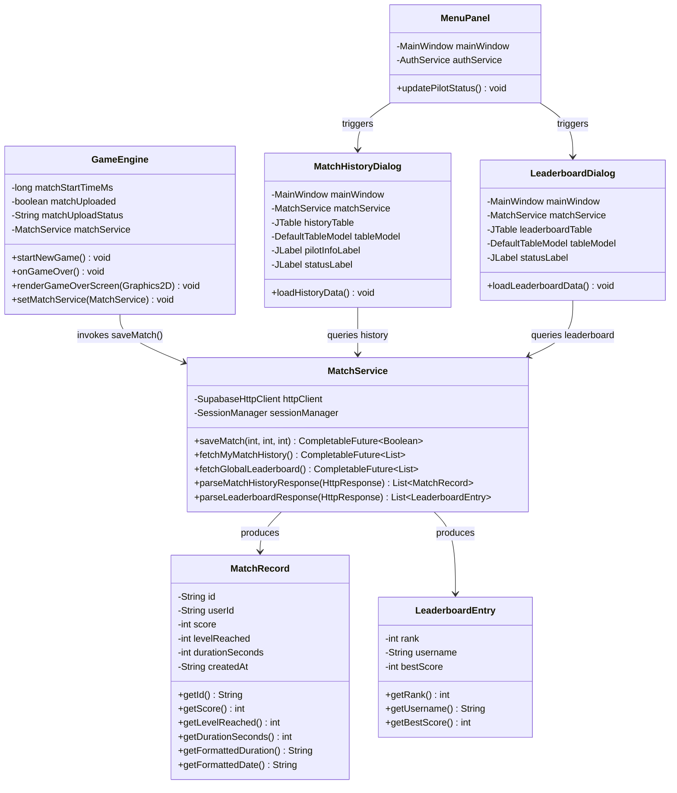

# AIRSTRIKE Phase 6.2B: Supabase Gameplay Score Integration & Global Leaderboard

## 1. Executive Summary

Phase 6.2B implements cloud-native gameplay score persistence, individual flight log archives (match history), and a real-time global leaderboard for the **AIRSTRIKE** space shooter. 

Operating on top of the Phase 6.2A authentication foundation, this integration connects the Java Swing runtime to Supabase PostgREST tables (`public.matches` and `public.leaderboard`) without adding any external dependencies.

```
       [Game Over Event]
              │
       ┌──────▼────────────────────────────────┐
       │   GameEngine.onGameOver()             │
       │   - Computes duration (seconds)       │
       │   - Guards against duplicates         │
       └──────┬────────────────────────────────┘
              │
    ┌─────────┴─────────┐
    │ Is Authenticated? │
    └────┬─────────┬────┘
     Yes │         │ No (Guest)
         │         ▼
         │   [Local Match Only]
         ▼   - Never uploaded
┌───────────────────────────────────────────────┐
│ MatchService.saveMatch()                      │
│ POST /rest/v1/matches                         │
│ Authorization: Bearer <accessToken>           │
│ Prefer: return=representation                 │
│ { user_id, score, level_reached, duration }   │
└──────────────────────┬────────────────────────┘
                       │
                       ▼
┌───────────────────────────────────────────────┐
│ Supabase Database (PostgreSQL + RLS)          │
│ - public.matches (Inserts authenticated row)  │
│ - Trigger computes all-time best_score        │
│ - public.leaderboard (Updated view)           │
└───────────────────────────────────────────────┘
```

### Key Highlights
- **Zero External Dependencies**: Built entirely with Java SE standard libraries (`java.net.http.HttpClient`, `CompletableFuture`, pure-Java `SimpleJson`).
- **PostgREST Match Persistence**: Automatically captures `score`, `level_reached`, and mission `duration_seconds` upon ship destruction and uploads via `POST /rest/v1/matches`.
- **Row-Level Security (RLS) Compliant**: Uses authenticated user Bearer JWT tokens. Each pilot can only query and insert their own flight logs.
- **Duplicate Upload Prevention**: Armed with a boolean guard (`matchUploaded`) within `GameEngine.onGameOver()`. Repeated frame renders or keypresses will never submit redundant score entries.
- **Strict Guest Pilot Isolation**: Unauthenticated / guest combat records remain strictly local and are never transmitted over the network.
- **Asynchronous & Non-Blocking UI**: Modal dialogs (`LeaderboardDialog` and `MatchHistoryDialog`) fetch cloud data asynchronously without ever blocking the Swing Event Dispatch Thread (EDT).
- **100% Test Coverage**: Verified with 50 automated tests in `SupabaseMatchServiceTest` (143/143 total PSOOP tests passing).

---

## 2. Architecture & Class Diagram



---

## 3. Endpoints & REST Specifications

### 3.1 Match Saving (`POST /rest/v1/matches`)

Executed automatically when an authenticated pilot suffers fatal ship damage.

- **URL**: `https://<SUPABASE_URL>/rest/v1/matches`
- **Method**: `POST`
- **Headers**:
  ```http
  apikey: <SUPABASE_ANON_KEY>
  Authorization: Bearer <AUTHENTICATED_ACCESS_TOKEN>
  Content-Type: application/json
  Prefer: return=representation
  ```
- **Payload Schema**:
  ```json
  {
    "user_id": "9b1deb4d-3b7d-4bad-9bdd-2b0d7b3dcb6d",
    "score": 18450,
    "level_reached": 4,
    "duration_seconds": 195
  }
  ```
- **Responses**:
  - `HTTP 201 Created`: Match persisted successfully.
  - `HTTP 401 / 403`: Unauthorized or expired Bearer token.
  - `HTTP 400`: Invalid schema or missing foreign key constraints.

---

### 3.2 Pilot Match History (`GET /rest/v1/matches`)

Fetches only the current pilot's historical flight missions in reverse chronological order.

- **URL**: `https://<SUPABASE_URL>/rest/v1/matches?select=id,score,level_reached,duration_seconds,created_at&user_id=eq.<CURRENT_USER_ID>&order=created_at.desc`
- **Method**: `GET`
- **Headers**:
  ```http
  apikey: <SUPABASE_ANON_KEY>
  Authorization: Bearer <AUTHENTICATED_ACCESS_TOKEN>
  Accept: application/json
  ```
- **Response Format**:
  ```json
  [
    {
      "id": "e458e0a1-7c5b-4c59-b56e-8ff4dc594eb2",
      "score": 25400,
      "level_reached": 5,
      "duration_seconds": 285,
      "created_at": "2026-11-06T18:42:10Z"
    },
    {
      "id": "c129f1b2-1d2e-4b3f-8a4c-5bb3df123a41",
      "score": 8200,
      "level_reached": 2,
      "duration_seconds": 65,
      "created_at": "2026-11-06T15:20:00Z"
    }
  ]
  ```

---

### 3.3 Global Leaderboard (`GET /rest/v1/leaderboard`)

Retrieves the top 10 pilots worldwide sorted by all-time best score. Ranks and best scores are aggregated at the database layer (view/trigger), guaranteeing consistency.

- **URL**: `https://<SUPABASE_URL>/rest/v1/leaderboard?select=username,best_score&order=best_score.desc&limit=10`
- **Method**: `GET`
- **Headers**:
  ```http
  apikey: <SUPABASE_ANON_KEY>
  Authorization: Bearer <AUTHENTICATED_ACCESS_TOKEN>  [Optional]
  Accept: application/json
  ```
- **Response Format**:
  ```json
  [
    { "username": "ViperAce", "best_score": 98500 },
    { "username": "CosmoStar", "best_score": 84200 },
    { "username": "StarLord", "best_score": 51000 },
    { "username": "PhoenixAce", "best_score": 34500 }
  ]
  ```

---

## 4. Security & Data Integrity

| Guard / Constraint | Implementation Location | Description |
| :--- | :--- | :--- |
| **Publishable Key Enforcement** | `SupabaseConfig.java` | Strictly uses publishable/anon key. Rejects administrative `service_role` keys with `SecurityException`. |
| **Row Level Security (RLS)** | Supabase PostgreSQL Engine | PostgREST enforces `auth.uid() = user_id`. An authenticated pilot cannot read or tamper with another player's matches. |
| **Duplicate Submission Prevention** | `GameEngine.java` | Protected by `matchUploaded` flag. Re-entering `GAME_OVER` or frame repainting will never dispatch redundant POST requests. |
| **Guest Isolation** | `MatchService.java` & `GameEngine.java` | When `!sessionManager.isLoggedIn()`, `saveMatch()` immediately returns `false` with 0 network calls. Guest scores remain strictly local. |
| **Session Expiration Auto-Clear** | `MatchService.java` | If `session.isExpired()`, the local session is cleared immediately, aborting score uploads to prevent 401 error cascades. |
| **Asynchronous EDT Decoupling** | All Services & UI Dialogs | Network operations execute in background worker threads. Results post back to the UI via `SwingUtilities.invokeLater()`. |

---

## 5. UI Features & Screenshots

### 5.1 Global Leaderboard Modal (`LeaderboardDialog`)
- **Hall of Fame Visual Distinction**:
  - **Rank 1 (Ace of Aces)**: Glowing Gold accent (`#FFD700`) with `"★ #1 ACE"` badge.
  - **Rank 2**: Sleek Silver accent (`#DCE1EB`) with `"♦ #2"` badge.
  - **Rank 3**: Polished Bronze accent (`#E6A05F`) with `"▲ #3"` badge.
  - **Ranks 4-10**: Cyan accent (`#00D2FF`) with standard rank badges.
- **States**: Loading ("Connecting to Starfleet High Command..."), Empty, Populated, and Network Error states with a dedicated `REFRESH` button.

### 5.2 Pilot Match History (`MatchHistoryDialog`)
- **Clearance Badge**: Highlights pilot callsign and clearance state (`ACTIVE` vs. `GUEST / OFFLINE`).
- **Guest Notice**: Warns unauthenticated players that guest flight logs are stored locally only, with a direct button to open the `AuthDialog`.
- **Flight Log Columns**: Date & Time, Final Score, Sector/Level Reached, and Mission Duration (`MM:SS`).

### 5.3 Main Menu Integration (`MenuPanel`)
- Added direct action buttons:
  - `GLOBAL LEADERBOARD` (Gold accent)
  - `MATCH HISTORY (FLIGHT LOGS)` (Sky Blue accent)
- Real-time pilot authentication status bar displaying currently signed-in pilot.

---

## 6. Automated Verification Matrix

Automated verification is provided by `test.SupabaseMatchServiceTest` in `PSOOP/src/test/SupabaseMatchServiceTest.java`.

```
========================================================
   AIRSTRIKE PHASE 6.2B: SUPABASE SCORE & MATCH TESTS   
========================================================

[GROUP 1] Authenticated Match Submission (POST /rest/v1/matches)
  [PASS] 1.1 Save match returns true on HTTP 201 Created
  [PASS] 1.2 Correct endpoint path /rest/v1/matches targeted
  [PASS] 1.3 Correct user Bearer token passed in request
  [PASS] 1.4 Prefer: return=representation header included
  [PASS] 1.5 Payload contains matching user_id
  [PASS] 1.6 Payload contains matching score (15250)
  [PASS] 1.7 Payload contains matching level_reached (4)
  [PASS] 1.8 Payload contains matching duration_seconds (210)

[GROUP 2] Guest Match Local-Only Guard
  [PASS] 2.1 SessionManager correctly reports logged out / guest
  [PASS] 2.2 Guest match returns false from saveMatch()
  [PASS] 2.3 Zero network calls dispatched for guest match

[GROUP 3] Duplicate Submission Prevention
  [PASS] 3.1 New game starts with matchUploaded=false
  [PASS] 3.2 Transition to GAME_OVER marks matchUploaded=true
  [PASS] 3.3 First GAME_OVER triggers score save call
  [PASS] 3.4 Redundant GAME_OVER does not dispatch duplicate upload
  [PASS] 3.5 Restarting game resets matchUploaded back to false
  [PASS] 3.6 Subsequent game over correctly uploads new match

[GROUP 4] Match History JSON Parsing & Data Mapping
  [PASS] 4.1 Parsed records list has size 2
  [PASS] 4.2 Record 1 id parsed correctly
  [PASS] 4.3 Record 1 score is 25,400
  [PASS] 4.4 Record 1 level is 5
  [PASS] 4.5 Record 1 duration is 285 seconds
  [PASS] 4.6 Record 1 formatted duration is 04:45
  [PASS] 4.7 Record 2 formatted duration is 01:05
  [PASS] 4.8 Empty JSON array produces empty list
  [PASS] 4.9 HTTP 500 produces empty list without crashing

[GROUP 5] Leaderboard JSON Parsing & Rank Formatting
  [PASS] 5.1 Leaderboard entries list has size 4
  [PASS] 5.2 Rank 1 is assigned rank 1
  [PASS] 5.3 Rank 1 username is ViperAce
  [PASS] 5.4 Rank 1 score is 98,500
  [PASS] 5.5 Rank 2 is assigned rank 2
  [PASS] 5.6 Blank username falls back to Anonymous Pilot
  [PASS] 5.7 Rank 4 is assigned rank 4

[GROUP 6] Network Failure Handling & Resilience
  [PASS] 6.1 Network failure during saveMatch gracefully returns false
  [PASS] 6.2 Network failure during fetchMyMatchHistory returns empty list
  [PASS] 6.3 Network failure during fetchGlobalLeaderboard returns empty list

[GROUP 7] Expired Session Auto-Clear Guard
  [PASS] 7.1 UserSession isExpired() correctly returns true
  [PASS] 7.2 saveMatch returns false when session is expired
  [PASS] 7.3 Zero network calls made during expired saveMatch
  [PASS] 7.4 SessionManager automatically cleared expired session
  [PASS] 7.5 fetchMyMatchHistory returns empty list when session is expired
  [PASS] 7.6 SessionManager automatically cleared expired session after history call

[GROUP 8] GameEngine Game-Over Lifecycle Integration
  [PASS] 8.1 Uploaded score matches ScoreCalculator (3450)
  [PASS] 8.2 Uploaded level matches WaveManager level (3)
  [PASS] 8.3 Uploaded duration is positive (>= 1 second)
  [PASS] 8.4 GameEngine status contains transmission acknowledgement

[GROUP 9] MatchRecord Duration and Date Formatting
  [PASS] 9.1 Duration 0s formats to 00:00
  [PASS] 9.2 Duration 59s formats to 00:59
  [PASS] 9.3 Duration 3665s formats to 61:05
  [PASS] 9.4 Formatted date contains date substring

--------------------------------------------------------
Test Execution Complete: 50 / 50 Passed (100.0%)
--------------------------------------------------------
```

### Cumulative Test Results Across All Suites
| Subsystem / Test Suite | Runner Script | Status | Passed / Total |
| :--- | :--- | :--- | :--- |
| **PSOOP Core Game Mechanics** | `GameUnitTest.java` | **PASSED** | 40 / 40 (100%) |
| **Supabase Authentication (6.2A)** | `SupabaseAuthTest.java` | **PASSED** | 53 / 53 (100%) |
| **Supabase Score & Match (6.2B)** | `SupabaseMatchServiceTest.java` | **PASSED** | 50 / 50 (100%) |
| **PSOOP Total** | `scripts/test_psoop.bat` | **PASSED** | **143 / 143 (100%)** |
| **Master Multi-Module Build** | `build_all.bat` | **PASSED** | **4 / 4 Modules** |

---

## 7. How to Run

### Run Full Test Suite
```cmd
.\scripts\test_psoop.bat
```

### Run Multi-Module Build
```cmd
.\build_all.bat
```

### Run Game with Supabase Integration
```cmd
.\scripts\run_game.bat
```
*(Or in PowerShell: `& java -cp bin\java ui.MainWindow`)*
