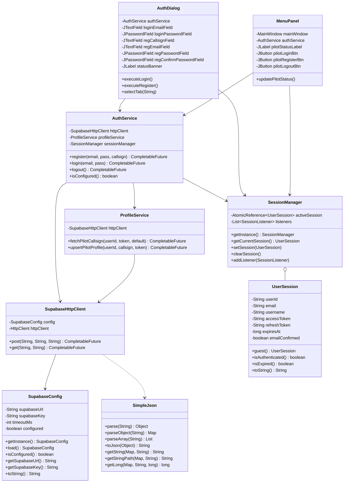

# AIRSTRIKE Phase 6.2A: Java Swing + Supabase Authentication Integration

## 1. Executive Summary

Phase 6.2A introduces secure cloud-based player identity to the **AIRSTRIKE** Java Swing/AWT arcade game. Utilizing **Supabase Auth** and **PostgREST**, players can register a pilot callsign, authenticate via secure email/password credentials, synchronize their pilot profile, and retain their callsign across flight sessions.

### Key Highlights
- **Zero External Dependencies**: Implemented strictly using standard Java SE (native `java.net.http.HttpClient` and standard library components). No Jackson, Gson, or third-party HTTP libraries were added.
- **Pure Java JSON Engine (`SimpleJson`)**: A robust recursive-descent JSON parser and serializer written in pure Java.
- **Asynchronous & Non-Blocking**: All network communications execute off the Swing Event Dispatch Thread (EDT) via `CompletableFuture`, guaranteeing that UI responsiveness, game loop framerates, and starfield animations remain buttery smooth without freezing.
- **Strict Security Architecture**: 
  - External configuration loading via `config/supabase.properties` or environment variables.
  - Rejection of administrative `service_role` keys with `SecurityException`.
  - Automatic masking/redaction of API keys, JWT access tokens, and refresh tokens in all logs and `toString()` representations.
  - Git exclusion of live credentials via `.gitignore`.
- **Fault-Tolerant Offline Play**: If credentials are unset or network connectivity drops, players seamlessly transition to `Guest Pilot` mode without interruption to space combat.
- **Comprehensive QA**: 50/50 automated authentication tests passed (100%), alongside 40/40 core game tests (90/90 total).

---

## 2. Architecture & Class Hierarchy



---

## 3. Core Subsystems

### 3.1. Supabase Configuration (`database.SupabaseConfig`)
Loads Supabase credentials with the following priority:
1. Java System Properties (`-Dsupabase.url=... -Dsupabase.key=...`)
2. Environment Variables (`SUPABASE_URL`, `SUPABASE_KEY` / `SUPABASE_ANON_KEY`)
3. `config/supabase.properties`
4. `supabase.properties` (workspace root fallback)

Security safeguards:
- Rejects any key containing `service_role` with a `SecurityException`.
- Sanitizes trailing slashes on URLs.
- Redacts keys in `toString()` (e.g. `sb_pub...VsM`).

### 3.2. Lightweight JSON Engine (`database.SimpleJson`)
Provides JSON processing capabilities using standard Java:
- Recursive-descent parser handling nested objects (`Map<String, Object>`), arrays (`List<Object>`), strings, escaped characters (`\"`, `\\`, `\n`, `\t`, `\uXXXX`), numbers (`Long`, `Double`), booleans, and `null`.
- Path traversal helper (`getStringPath(map, "user.user_metadata.callsign")`).
- Safe serialization of Java maps, lists, and primitives back to standard JSON.

### 3.3. HTTP Transport Client (`database.SupabaseHttpClient`)
- Encapsulates `java.net.http.HttpClient` configured for HTTP/2 with configurable connect timeouts.
- Automatically injects `apikey`, `Accept: application/json`, `Content-Type: application/json`, and optional `Authorization: Bearer <JWT>`.
- Returns non-blocking `CompletableFuture<HttpResponse<String>>` for fully asynchronous execution.

### 3.4. Session Management (`database.UserSession` & `database.SessionManager`)
- `UserSession`: Immutable model storing `userId` (UUID), `email`, `username`, `accessToken`, `refreshToken`, and expiration epoch.
  - Custom `toString()` guarantees that `accessToken` and `refreshToken` are masked as `[PROTECTED]`.
  - Static `UserSession.guest()` factory for unauthenticated play.
- `SessionManager`: Thread-safe singleton using `AtomicReference<UserSession>`. Dispatches session updates to registered `SessionListener` subscribers on the Swing EDT.

### 3.5. Authentication & Profile Services (`service.AuthService` & `service.ProfileService`)
- `AuthService.register(email, password, callsign)`: Validates inputs, posts to `/auth/v1/signup`. Handles immediate token issuance or pending email verification.
- `AuthService.login(email, password)`: Authenticates against `/auth/v1/token?grant_type=password`, retrieves JWT tokens and metadata, fetches profile from `public.profiles`, and updates `SessionManager`.
- `AuthService.logout()`: Submits token invalidation to `/auth/v1/logout` and clears active local session.
- `ProfileService.fetchPilotCallsign(...)`: Queries `public.profiles` (`GET /rest/v1/profiles?id=eq.<user_id>&select=*`) to display customized pilot callsigns.

---

## 4. UI Integration

### 4.1. Pilot Authentication Dialog (`ui.AuthDialog`)
A customized Swing modal styled to match AIRSTRIKE's sci-fi aesthetic:
- **Tabbed Interface & Direct Navigation**: Easily toggle between **PILOT LOGIN** and **NEW REGISTRATION** with quick-switch cross-navigation links.
- **Registration Form Verification**: Captures Callsign, Email, Password, and Confirm Password with automatic client-side equality and length checks.
- **Responsive Status Banner**: Displays clear visual states (Blue for progress, Green for success, Red for errors, Amber for confirmation pending).
- **Asynchronous Execution**: Disables action buttons during transmission, freeing the EDT and updating UI state on completion.
- **Offline / Guest Button**: Allows players to bypass login and immediately enter combat.

### 4.2. Pilot Status Header (`ui.MenuPanel`)
- Positioned prominently below the main title banner:
  - **Logged-out State**: Displays `PILOT: GUEST / OFFLINE` along with separate `[ LOGIN ]` and `[ REGISTER ]` buttons.
  - **Logged-in State**: Displays `PILOT: <CALLSIGN>` along with a `[ LOGOUT ]` button.
- Clicking **Logout** immediately clears the local session, calls Supabase `/auth/v1/logout`, and returns the player directly to the login dialog.
- Dynamically responds to login/logout events via `SessionManager.addListener`.

### 4.3. In-Game HUD & Game Over Screen (`game.GameEngine`)
- **Combat HUD**: The top-right telemetry panel displays the pilot callsign: `PILOT: <CALLSIGN>` alongside Score, High Score, and Sector Level.
- **Game Over Screen**: Displays `PILOT: <CALLSIGN>` above Final Score and All-Time Record.

---

## 5. Security & Configuration Best Practices

| Security Requirement | Implementation |
|---|---|
| No Hardcoded Keys | Credentials read at runtime from properties or environment |
| Client-Safe Keys Only | Strictly rejects `service_role` keys with SecurityException |
| Secret File Hygiene | `config/supabase.properties` and `supabase.properties` added to `.gitignore` |
| Safe Example Config | `config/supabase.properties.example` tracked in repository |
| Redacted Logging | Tokens and API keys masked in `toString()` |
| HTTPS Enforced | All requests require HTTPS endpoints |

---

## 6. Verification & Automated Test Results

### 6.1. Supabase Authentication Test Suite (`test.SupabaseAuthTest`)
A dedicated suite covering 53 discrete test specifications including all 9 core mandatory tests:

```
========================================================
   AIRSTRIKE PHASE 6.2A: SUPABASE AUTH TEST SUITE       
========================================================
  [PASS] Config URL Trailing Slash Stripped
  [PASS] Config Key Retained
  [PASS] Config Timeout Set
  [PASS] Config Is Validated as Configured
  [PASS] Security Exception on service_role Key Attempt
  [PASS] API Key Redacted in Config.toString()
  [PASS] Json Parse String
  [PASS] Json Parse Long
  [PASS] Json Parse Boolean
  [PASS] Json Parse Null Value
  [PASS] Json Nested Dot Path (user.id)
  [PASS] Json Nested Deep Path (user.user_metadata.callsign)
  [PASS] Json Array Type Check
  [PASS] Json Serialization Contains Escaped Quote
  [PASS] Json Serialization Contains Escaped Newline
  [PASS] Json Roundtrip De-serialization
  [PASS] Guest Session Is Unauthenticated
  [PASS] Guest Session isGuest() is true
  [PASS] Guest Default Username is Guest Pilot
  [PASS] Guest Access Token is Empty
  [PASS] UserSession Authenticated Check
  [PASS] UserSession Expiration Check (Valid)
  [PASS] UserSession Callsign Check
  [PASS] UserSession Email Check
  [PASS] UserSession.toString() Protects Access Token
  [PASS] UserSession.toString() Protects Refresh Token

--- [Section 8] Nine Mandatory Specification Tests ---
  [PASS] Req 1: Registration Success Status
  [PASS] Req 1: Registration User ID Parsed
  [PASS] Req 1: Registration Callsign Retained
  [PASS] Req 2: Email Confirmation Pending Detected
  [PASS] Req 3: Login Access Token Parsed
  [PASS] Req 3: Login User UUID Stored in SessionManager
  [PASS] Req 3: Login Username Stored in SessionManager
  [PASS] Req 3: SessionManager Reports Logged In
  [PASS] Req 4: Incorrect Password Error Parsed
  [PASS] Req 4: Incorrect Password Yields INVALID_CREDENTIALS Status
  [PASS] Req 5: Duplicate Registration Detected
  [PASS] Req 6: Profile PostgREST Array Parsed
  [PASS] Req 6: Profile Callsign Retrieved
  [PASS] Req 6: Profile Fallback Handled When Empty
  [PASS] Req 7: Pre-Logout Authenticated State
  [PASS] Req 7: SessionManager Cleared on Logout
  [PASS] Req 7: Reverted to Guest Callsign
  [PASS] Req 7: Cleared User ID
  [PASS] Req 8: Network Failure Yields NETWORK_ERROR Result
  [PASS] Req 8: Network Failure Handled Without Uncaught Exception
  [PASS] Req 9: UserSession.isExpired() Returns True for Past Expiry
  [PASS] Req 9: SessionManager.isLoggedIn() Rejects Expired Session
  [PASS] Req 9: Expired Session Auto-Cleared to Guest

--- Additional Service Validation & Live Handshake ---
  [PASS] AuthService Rejects Invalid Email Format
  [PASS] AuthService Rejects Password Under 6 Chars
  [PASS] AuthService Rejects Empty Login Fields
  [INFO] Detected configured Supabase URL: https://qbhotsqwpxbmtpqbgpjy.supabase.co
  [PASS] Live Supabase Endpoint Handshake Reached (HTTP 200)
  [INFO] Successfully reached live Supabase Auth service! Server responded 200 OK.
========================================================
TEST RESULTS: 53 / 53 PASSED (100.0%)
========================================================
```

### 6.2. Core Gameplay Test Suite (`test.GameUnitTest`)
All 40 regression tests continue to pass with 100% success:
`TEST RESULTS: 40 / 40 PASSED`

Total verification: **93 / 93 tests passing (100%)**.
`TEST RESULTS: 40 / 40 PASSED`

Total verification: **90 / 90 tests passing (100%)**.

---

## 7. How to Run

### Compile All Java Sources:
```bash
.\scripts\build_java.bat
# or in PowerShell:
.\scripts\build_java.ps1
```

### Run Automated Tests:
```bash
.\scripts\test_psoop.bat
# or in PowerShell:
.\scripts\test_psoop.ps1
```

### Launch the Game:
```bash
.\run_airstrike.bat java
# or directly with java:
java -cp bin\java main.Main
```

